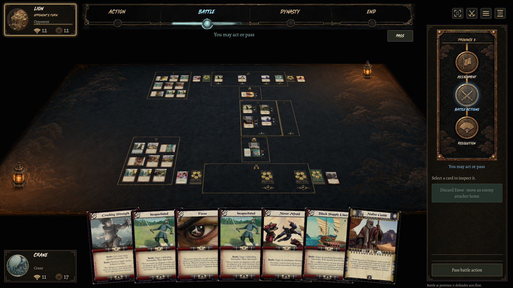
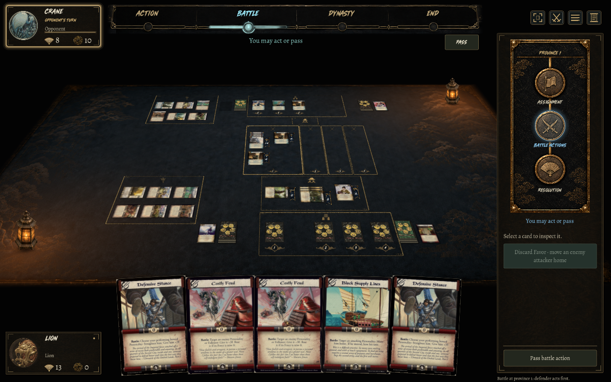
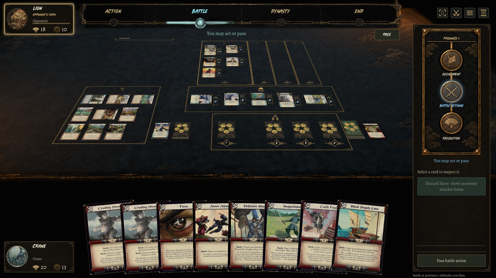

# Ink mat implementation and review

Issue #52 / PR #53 — 2026-09-08 — native macOS Godot 4.7.2 .NET.

The approved C direction is implemented as textured, animated mat sections. Holdings are grouped on screen-left, other Home cards remain separate, and actual battles use province-specific fields. Existing full card scans, stat inlays, unit standards, rules authority and manual camera controls remain in use.

## Latest icon and province-seal pass

Alfredo replaced permanent box wording with intuitive emblems. Generated gold-pigment sprites now mark Holdings (rice sheaf), Home (residence), Provinces (fortified gate), and battlefields (crossed swords). The existing delayed reading tooltip provides each name without capturing input. Province numbers use a separate aged ceremonial surround under each resting slot; battlefields repeat their destination seal below the units. Header/footer space is reserved for this artwork. Numbers remain attached to an empty surviving slot, and card hover does not move them.

Final local validation after this change:

- C# compilation and Godot import: passed, zero warnings/errors.
- `bash tools/check-ink-mat.sh`: all three native views passed, including original layout/card/attachment checks, plus native icon hover routing, polygon clearance against actual card faces, stable below-card province seals, and the empty/hidden/detached-slot checks. The isolated ink lifecycle checks also passed.
- The real Remote Village purchase film passed: 120 frames, 24 fps, version 18 to 19, in-play group four to five including Stronghold. Reviewed moving, settled and revealing frames. [Native recording](screenshots/ink-mat/ink-apparition.mp4) is a five-second authored-time capture, not a performance benchmark.
- `bash tools/check-table-camera.sh`: all eight native cases passed again, covering pan/zoom, bowed card input, assignment, attachment inspection, pile tooltip, 16:10, ultrawide and reduced motion. Reduced-motion frames at different light phases were identical.
- Refreshed Mac launcher; its current-checkout entry passed `bash 'Play Latest.command' --headless --quit-after 2`.
- Visual review covered the small window, crowded board and closer player-side framing. Seals have reserved space beneath cards; hover targets remain pointer-transparent. The corner lamp position now uses a fitted-camera gutter, avoiding Holdings on compact boards without following manual camera movement.

Exact built-in ImageGen prompts and runtime asset paths are in [EMBLEMS.md](../assets/ui/ink-mat/EMBLEMS.md). Expert rules acceptance and native Windows graphical playtesting are not claimed.

## Reviewed native views

These are unaltered game captures from real practice states, not generated game screenshots. Practice shuffles vary, so the three pictures are different positions in different matches.

The focused view intentionally crops the opponent's side; Fit Table returns to the complete layout. The material follows C's worn ink and cloud motifs, with a brighter pigment and inset ornaments adapted to gameplay. It is not a literal pixel copy of the concept sheet.

## Follow-up: settle first, then ink; weathered corner lamps

Alfredo accepted the settled frame but corrected the motion: the border should appear after cards move. The new renderer holds its incoming pigment at zero until actual card flights, table reflow, bowing and pile settling finish. Following a brief quiet pause, ink seeps outward from opposing corners with uneven local absorption, then stops. Outgoing ink and labels dissolve in place instead of stretching.

Labels now use restrained Alegreya serif at 14 screen pixels (12 minimum); the corner motifs are half the previous width. Lamps move toward the lower-left and upper-right corners, with card-plane clearance and a fitted-view margin after checking compact tables and small windows. The placement derives from the fit camera so manual panning never pins a lamp to the screen edge. A generated weathering plate uses the original cutout silhouette. Mipmaps remove sparkling detail at small sizes, and continuous sampling with soft coverage removes rectangular glow seams and prevents the texture from extending beyond its silhouette. One shared candle-energy function synchronizes each lamp's softly moving flame, emitted glow, mat spill and nearby card lighting. The hand and reading popovers stay evenly lit.

Follow-up validation:

- Client build: zero warnings/errors; Godot import successful.
- Native ink suite: three actual board fixtures (1920×1080 overview/focus and 1280×800), attachment expand/inspect/fold, card/mat clearance, selection invariance and province identifiers passed.
- Isolated renderer regressions: deliberately hold the motion gate closed for two seconds; assert no incoming ink. Verify the post-settle pause and intermediate reveal, repeat Sync during waiting/reveal, retarget during spreading, dissolve removal, immediate reduced motion while waiting, and fresh-match reset.
- Real purchase film: 120 authored-time frames at 24 fps. The engine accepts one offered Holding purchase and the group grows from four to five including the Stronghold. Every recorded moving-card frame has zero incoming pigment; intermediate pigment appears only after movement settles. The camera remains fixed and the final card membership, opacity and pile counts are correct. Replay and frame telemetry accompany the movie. One later recording aborted on a camera change at frame 75, after the move/reveal had settled. The demonstration now consumes live wheel/key/click input while retaining the automatic-camera assertion; normal play and camera-input tests are unchanged.
- Eight native camera/input cases passed, including bowed edge hits, assignment, attachment expansion, pile tooltip, 16:10, ultrawide and reduced motion. The reduced-motion check renders at two independent light phases and requires byte-identical frames.
- Inspected before/during/after captures. Corrected texture undersampling, a too-small left lamp margin at 1280×800, and faint alpha fringe artifacts. Numerically compared settled film frames: nearby cards and fabric change with the candle; the hand remains pixel-identical. This is native renderer evidence, not a real-time performance benchmark.

The initial rules/network suite below is historical evidence for this PR's original implementation. The follow-up changes presentation only and does not claim a fresh expert rules acceptance or native Windows playtest.

## Initial implementation validation (b3db820)

- `bash tools/check.sh --skip-client`: passed. 31 collaboration, 85 content, 56 foundation, 32 published, 8 deck-format, 13 AI, 5 server and 4 client-transport checks.
- Client compilation: zero warnings/errors. Native Godot import passed.
- `bash tools/check-ink-mat.sh`: three native board fixtures at 1920 × 1080 and 1280 × 800, plus a 72-frame purchase film. Verifies disjoint labeled regions, left holdings, exact card membership, section clearance, hover/select/deselect invariance, actual attachment expand/inspect/fold, and empty surviving province markers. Final fixtures include Home stacks of one and three attachments and battlefield stacks of two and four attachments.
- Isolated native renderer checks: expansion, contraction, intermediate geometry, interruption/retargeting without jumping, unchanged-sync stability, removal fade, reduced motion and fresh-match reset. These are explicitly representative rectangles rather than fabricated gameplay events.
- Purchase film: a real engine-offered Holding purchase changes the displayed in-play group from four to five cards including the Stronghold. The border grows from 474 to 694 logical units wide; cards and piles reflow in their real table plane; camera remains fixed. Replay and per-frame geometry are written beside the capture. Capture waits for `FramePostDraw` so new controls have actually rendered.
- Existing board matrix: all 17 assignment, defense, target, purchase, refresh, choice, rules and aspect-ratio cases passed. The Shinden setup originally ended its random practice without encountering the choice; setup now searches another real match before the UI assertion. The affected choice case and remaining rules case were rerun successfully. No failing UI assertion is retried.
- `bash tools/check-table-camera.sh`: eight cases passed, including native pointer/key routing, projected upright/bowed edge clicks, modal isolation, attachments, pile tooltip, reduced motion, 16:10 and ultrawide views. Its modal probe now opens the real Rules dialog because Options is a main-menu page; repeated edge clicks account for the approved deselect toggle.
- `bash tools/check-card-deselection.sh`: battle, attack assignment, defense assignment and target-confirmation cases passed.

Ignored local evidence lives under `artifacts/checks`, `artifacts/table-camera`, and `artifacts/screenshots`. Run the ink script to regenerate the 24 fps film frames and replay. The movie is an authored-time native capture, not a real-time frame-rate benchmark.

## Adversarial review and iteration

Independent source and visual review identified: raw-scan reflow losing stat overlays/flags; hover creating false reflow; empty provinces losing identifiers; null-snapshot refresh; very narrow labels; attachment-tray metadata; hand/border clearance; stale camera tests. These were corrected. Live card/pile interpolation now preserves actual controls and their overlays; hovering and opening trays do not resize sections. The review also rejected barely visible initial ink and undersized labels before the present material was selected.

No authoritative rules, server protocol or card data changed. Mendon's review remains appropriate for the battlefield grouping and shared client file. These checks are not expert L5R rules acceptance or native Windows graphical playtesting. Assignment previews and cinematic resolution/destruction remain later passes.
