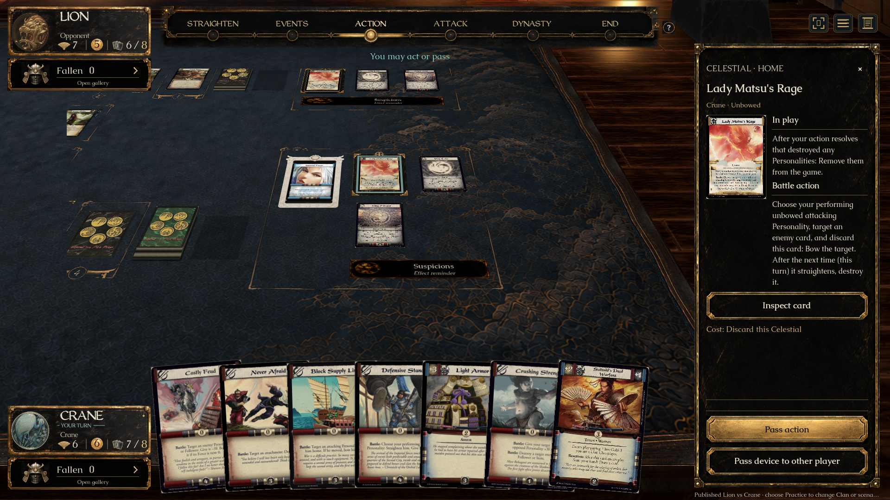
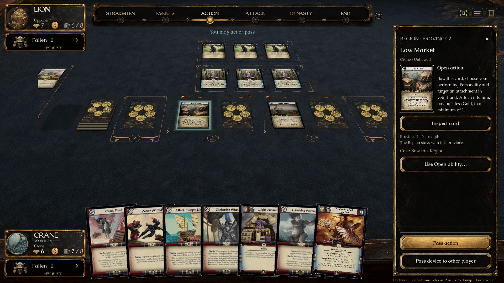

# Regions and Celestials — approved A + B + C implementation

Issue [#291](https://github.com/alfredoh7/l5r-emperor/issues/291), PR [#292](https://github.com/alfredoh7/l5r-emperor/pull/292). Alfredo selected this combination on 2026-09-18. The native implementation retains the existing game/HUD and the complete original card scans.

## What players see

- A Region sits to the **left** of its province’s current Dynasty card. Both full faces share one thin province boundary and numbered seal. The Region bows independently and remains when the Dynasty slot refills. A destroyed province loses its Region; no permanent empty Region slot is drawn.
- Each player’s Celestial is a full card in B’s black lacquer/brass frame, beside that player’s existing Home/Favor group. It is independent of Imperial Favor. Replacement, spending and removal clear the old mount. Celestials are included in existing card-transfer motion; reduced motion makes transfers immediate.
- Selecting either card opens C’s small original portrait with separate printed in-play and ability sections. **Inspect card** opens the complete original scan beside readable text. Region owner, province and effective strength come from the public view. Inspection submits no game command.
- Ability review shows the printed ability, engine-offered performer and target choices, and explicit bow/discard costs. Low Market shows the authoritative Gold price and selectable payment sources. Confirm submits the engine command with the chosen target/payment. Fallow Lands remains available through the real attack-reaction window.

The pinned Lion/Crane decks and card printing provenance are unchanged. The review launcher uses a prepared state through the real engine; it is not evidence that these support cards were added to the pinned decks.

## Artwork and comparison

Exact approved concepts: `assets/ui/regions-celestials/approved-{a,b,c}.png`. The decision is recorded in [2026-09-18-regions-celestials-presentation.md](decisions/2026-09-18-regions-celestials-presentation.md).

- Region contours reuse the warm ornamental pixels from A and the existing proportional province numeral seal. Corners keep their size; plain runs span the pair.
- Celestial artwork is a transparent production sprite derived from B using the built-in imagegen workflow. A second pass corrected rounded corner plates to stepped angular brass brackets. Prompt and SHA-256 provenance are retained under `assets/ui/regions-celestials/`.
- Full scans are unchanged. Generated concept card text is never used as a rule or playing-card source.

[Native source/comparison plate](screenshots/regions-celestials/comparison.png) presents unchanged concept and native-capture details at matching component widths. It is rendered in Godot as an art-review plate, separately from gameplay screenshots. The optional [comparison page](screenshots/regions-celestials/comparison.html) also links the full source images.

The selected layout/behavior is implemented. The Celestial lacquer grain and small ornamental details are derived artwork rather than pixel extraction. Existing native perspective, lighting, live layout and HUD remain; **whole-screen pixel equivalence is not claimed**.





## Shared contract change

Low Market already validated its discounted attachment payment in Core, but its action query omitted `GoldCost`. This left the client unable to display/select that payment correctly. `CardAbilities.cs` now groups eligible attachment targets by the engine-calculated cost and returns `ActionOption.GoldCost` for each group. The UI changes between offered groups when the target changes; it never computes the discount. A query-to-command regression covers mixed prices, minimum-one pricing, source bowing and successful attachment for every advertised target.

Other shared work: the branch preserves the stabilized UI stack and integrates current main through Nikutai fix #290 and Strategy wave 14 #294. The test-list merge retains the new Strategy regression and existing UI regressions, without duplicating the already-registered Battle/Open case. Shared presentation and the Gold metadata require mdornbrook review. The PR remains based on stabilization PR #275 until the existing UI stack lands.

The development launcher exposed stale catalogue-art coverage after integrating the newer published cards. The verified WebP85 pack was rebuilt to 2,812 scans and published as private [catalogue-art-webp-v9-20260918](https://github.com/alfredoh7/l5r-emperor/releases/tag/catalogue-art-webp-v9-20260918). The pinned receipt/manifest and local installation are updated; originals and printings are unchanged.

## Reproduction and evidence

```sh
bash tools/check.sh
bash tools/check-support-cards.sh
bash tools/check-persistent-home.sh
python3 tools/create-dev-launcher.py
```

Recorded on native macOS / Apple M1 Max, Godot 4.7.2 .NET:

- **496 deterministic checks passed:** collaboration 43, content 130, core 204, published 57, deck-format 9, deck-workshop 10, custom Practice 13, AI 20, server 5, client transport 5.
- Client compilation: zero warnings/errors. Godot import/headless smoke passed. The final integrated default probe was rerun after #294 and the confirmation-text adjustment.
- The normal launcher passed its headless smoke after artwork installation. The clickable review app was actually launched and verified via its running checkout/arguments and saved prepared-table framebuffer.
- Native support matrix: 1920×1080 default and crowded; 1280×800 opposite seat; 1440×900 crowded opposite seat; 1920×1080 normal motion. Both owners’ cards, independent province slots, fitted bounds, projected clicks, full inspection and no inspection commands verified.
- Real-command native checks: Low Market payment/attachment and independent bow; Lady Matsu’s Rage discard and Favor/opponent independence; Events Region entry/refill and Celestial replacement; province destruction; empty support state; Fallow Lands attack reaction changes strength from 5 to 3.
- Existing Home/Favor native integration passed at 1920×1080 reduced motion and 1440×900 normal motion.
- Native probes isolate tagged test mouse input; interactive review mode accepts ordinary input. A stray live mouse event during an early opposite-seat run exposed the need for this existing-probe convention.

Raw full matrix images/logs are reproducible under ignored `artifacts/checks/support-cards/`. Curated evidence lives in `docs/screenshots/regions-celestials/`.

## Try it

`Review Regions and Celestials.command` opens a prepared practice table with both players’ Regions, Celestials, Rings and Favor. Click a Region or Celestial, inspect it, and use its available engine actions. This is a local same-device review fixture, without an automated opponent. The normal current-checkout launcher remains `Play Latest.command` / the generated `artifacts/L5R Emperor - Latest.app`.

Remaining acceptance: Alfredo’s in-game visual review, mdornbrook’s shared/rules review, CI and the existing UI stack’s merge order. Native Windows graphical playtesting and expert full-match rules acceptance are not claimed by these Mac probes.
