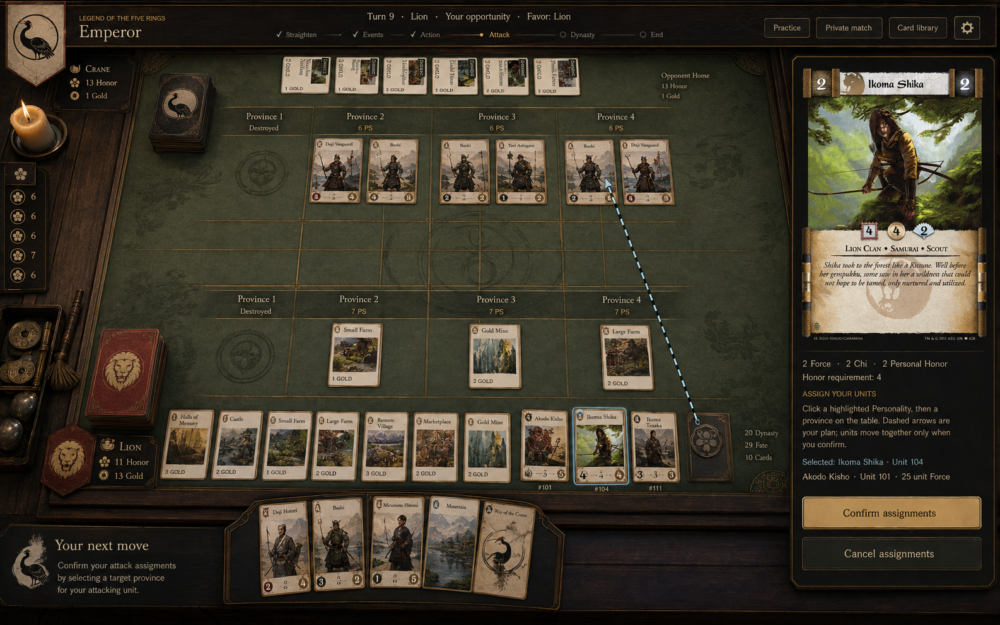
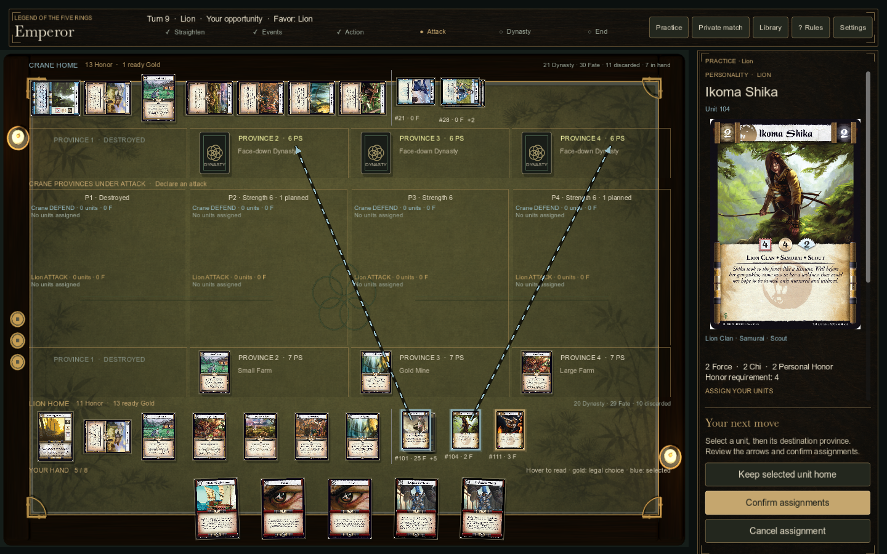
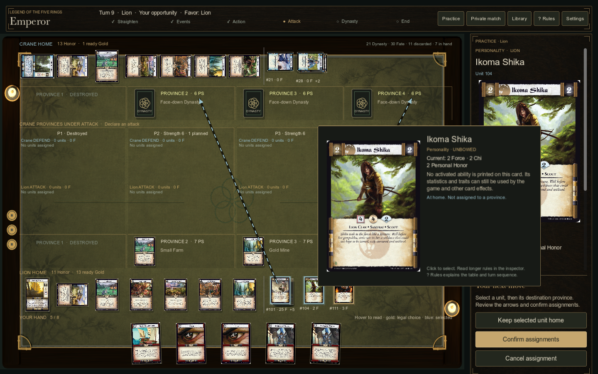
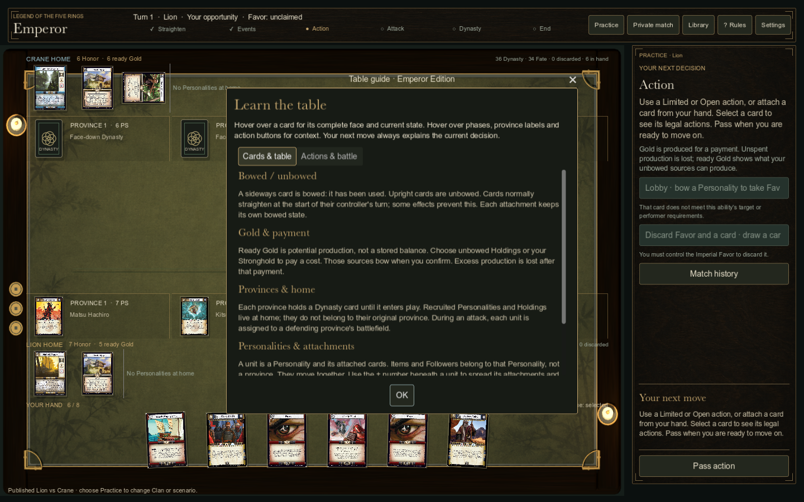

# UI visual review · 0.3.0

Generated target, developed with built-in Imagegen:

Final native screenshot from the packaged Mac game:

The implementation preserves original card scans and real game-state information. The target's material palette and hierarchy guide the result; the decorative clan banners/deck props and exact illustration layout are not reproduced. See [implementation and differences](UI_POLISH.md) and [exact generation prompts](../assets/concepts/polish-prompts.json).

Full-card hover, with the pending assignment preserved:

Beginner table guide:

