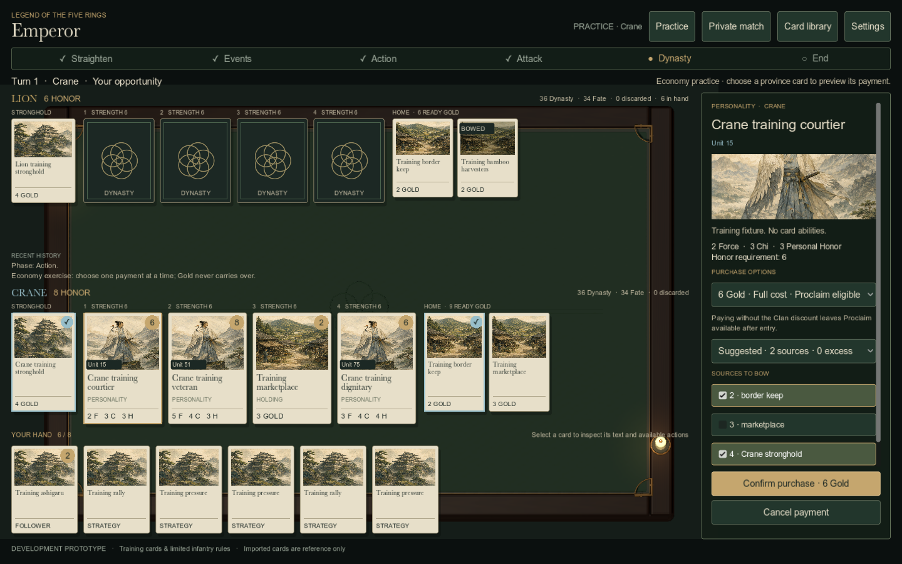
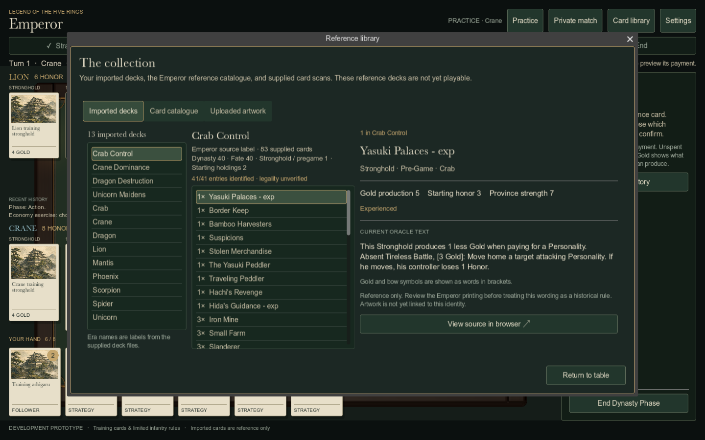
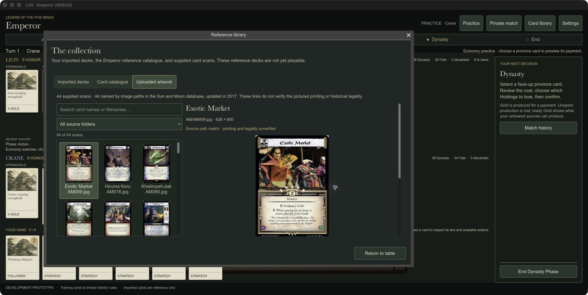
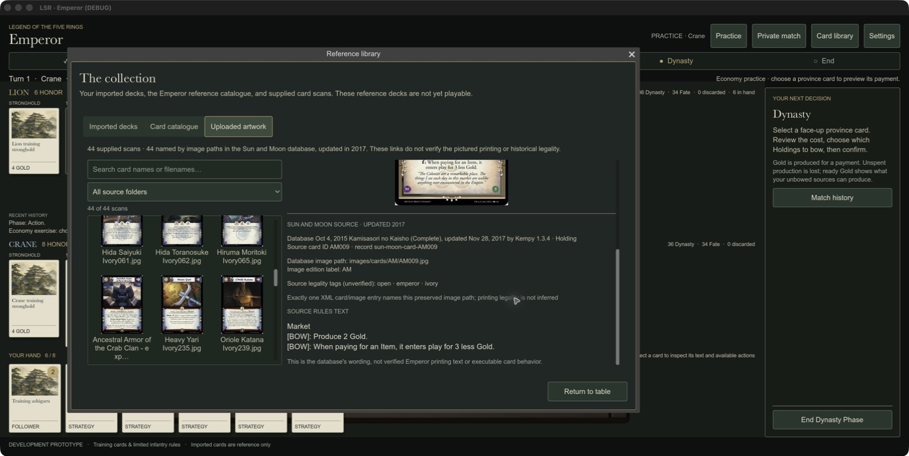
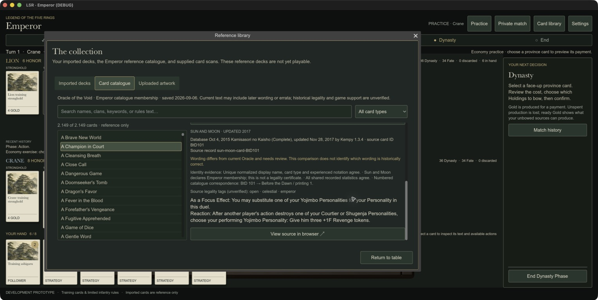
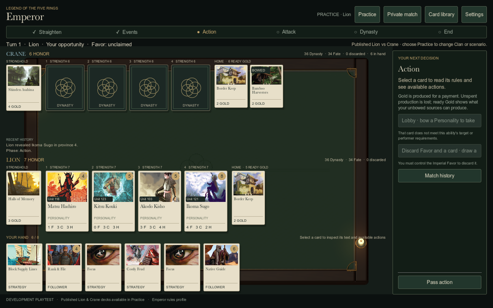
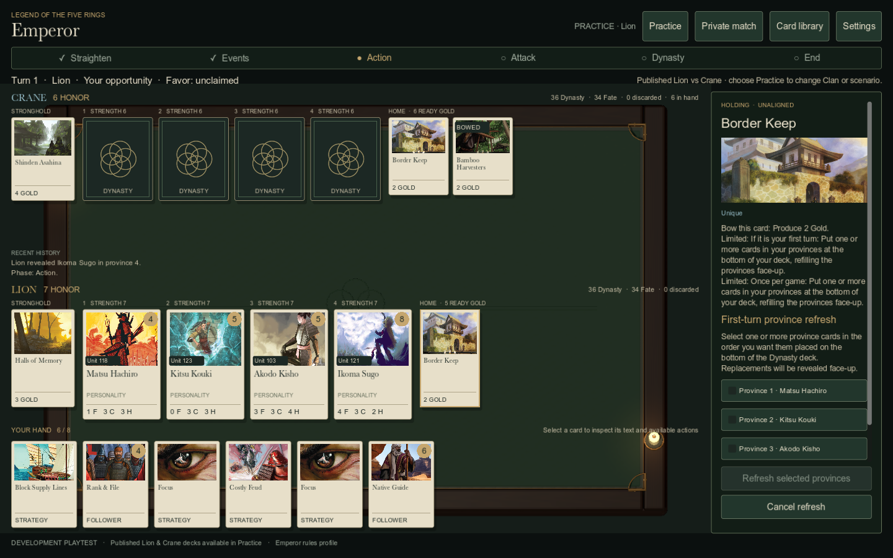
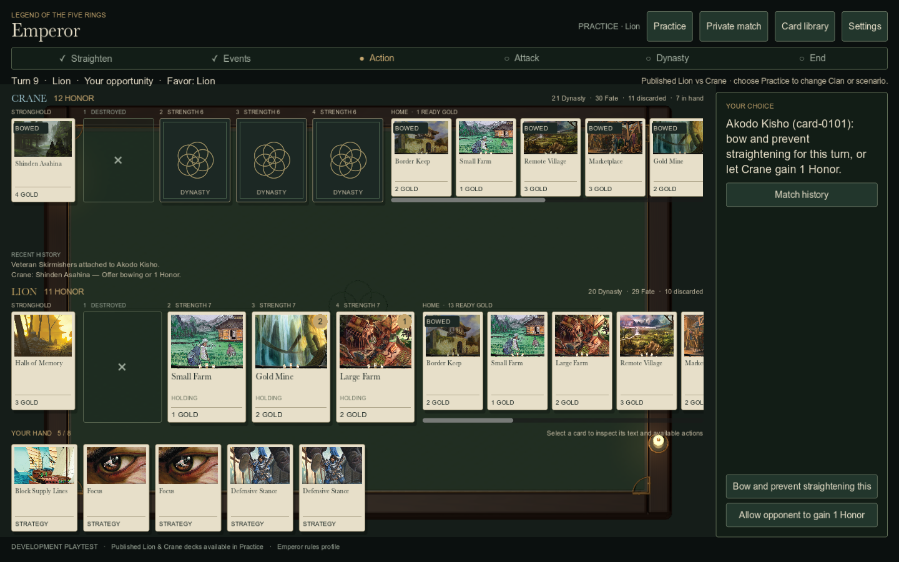
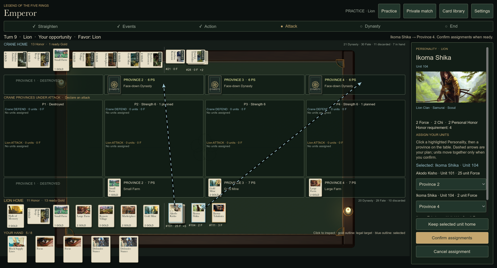
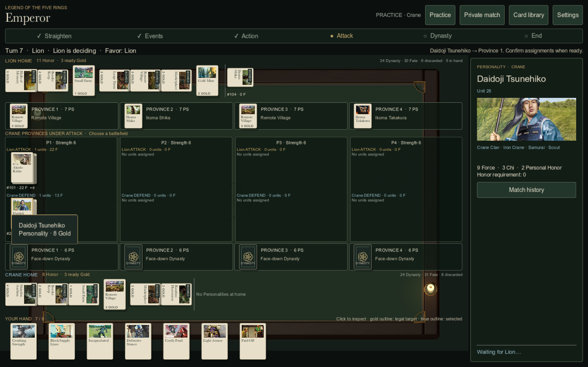

# Validation record — 6 September 2026

This record distinguishes executable checks, native visual checks, and work that remains unverified. The product is a training prototype, not a completed historical Emperor implementation.

## Automated checks

| Suite | Passed | Coverage |
|---|---:|---|
| Content | 15 | Archive intake, deck parsing, identities, source preservation and validation |
| Rules core | 36 | Payments, Clan options, Proclaim timing, turn flow, hidden views, infantry battles, attachments, victory and replay |
| Practice AI | 8 | Legal decisions from private views; five complete seeded matches and replay agreement |
| Server | 5 | Actual HTTP/WebSocket rooms, seat authentication, privacy, duplicate/stale commands, concurrent commands, restart, rollback, reconnect and invalid messages |
| Client transport | 3 | Actual client/server command binding, rejection recovery, overlapping reconnects and presence |
| **Total** | **67** | Passed through `tools/check.sh` |

The final C# client builds with zero warnings and errors. Godot imports its assets and runs the headless scene smoke successfully. Native screenshot checks require a graphical desktop and are separate from these suites.

## Native macOS evidence

Host: Apple M1 Max, macOS 26.5. Godot 4.7.2 .NET, Compatibility renderer using the Apple OpenGL/Metal driver. Pinned .NET SDK 10.0.400.

- Ran the source project at 1280×720, 1440×900 and 1920×1080. Inspected real viewport captures and corrected card-text overlap, brightness, confirmation-button placement and library window sizing.
- Ran the **final exported `.app`**, including native rendering and its bundled .NET runtime. The real purchase confirmation handler passed the smoke assertion and opened the Proclaim reaction; selected Gold sources were bowed, Honor stayed unchanged until the reaction, and the replacement province card stayed face down.
- Interactively selected a province card and confirmed a Clan-discount purchase in the standalone app. The Stronghold bowed, ready Gold decreased from 9 to 5, the Personality entered Home, and the province refilled face down.
- Interactively opened all library tabs, displayed an uploaded card scan, searched the catalogue for `Doji` (42 matching reference records), and returned to the table.
- Reviewed the final action mapping against the engine. Corrected independent Force contribution from unbowed Followers, conditional Proclaim labels and duplicate-Personality target identification.

Representative native screenshots:

Full captures and capture logs are in `artifacts/screenshots/`. `tools/capture.sh` reproduces the source-build captures; the final package was also run directly with the same capture arguments.

## Desktop package checks

- **macOS:** `artifacts/macos/L5R-Emperor.zip` and extracted `L5R · Emperor.app`. Universal x86_64/arm64 engine, both architecture-specific .NET runtimes and game assemblies, embedded game pack, library and all 44 uploaded images verified. The actual packaged executable starts successfully with the project SDK variables removed.
- **Windows:** `artifacts/windows/L5R-Emperor-Windows.zip`. Contains the x86_64 executable, PCK and `data_L5R.Client_windows_x86_64` runtime directory. PE architecture, required native/managed libraries, resources and ZIP CRC verified. Keep the full archive contents together.
- Export validation rejects Godot error output even when Godot exits with code zero, then checks required assemblies/resources before publishing the package. Raw C# source contents are excluded.
- This Mac rejected the DER entitlements generated by Godot's built-in ad-hoc signer. The exporter now regenerates the project-owned bundle signature with Apple's `codesign`, verifies it, runs the packaged executable, and only then produces the final ZIP. No macOS protection or quarantine setting is disabled.
- Final package sizes and SHA-256 hashes are recorded in `artifacts/checks/package-manifest.json`. Import, export and packaged-runtime logs are alongside it.

## Additional Sun and Moon database intake

The original full-suite result above records the foundation delivery. After the additional archive was supplied, the expanded **52-test content suite** passed: 15 original checks, eight XML-intake checks, ten conservative identity-matching checks and 19 client-packaging regressions. The unchanged engine, AI, server and transport suites were not rerun for this data/library change.

Verified the original XML checksum against its manifest and all 44 packaged image checksums against the uploaded originals. The client bundle contains 2,149 catalogue cards, 13 decks, 44 source-linked scans and 1,883 corroborated legacy references. All imported cards and decks remain non-playable. Raw XML, the full 12,033-record reference catalogue and local source paths are excluded from the client bundle.

Native macOS inspection confirmed named gallery thumbnails and the scrollable, dated Sun and Moon text and source evidence. Searching artwork for `Exotic` found the two expected scans. The catalogue's source-reference toggle expanded and collapsed correctly, while catalogue search continued to filter the original 2,149-card pool. The source text is separate from current Oracle text.

The updated C# client built with zero warnings and errors. Both desktop exports were refreshed and their embedded library bytes matched the current 2,844,603-byte bundle. The Mac signature and packaged-executable smoke passed again; Windows remains export-validated only. The refreshed Mac ZIP is 145,452,420 bytes and the Windows ZIP is 90,223,722 bytes. Current hashes are in `artifacts/checks/package-manifest.json`; this refresh's combined output is in `artifacts/checks/legacy-intake-export.log`.

## Published Lion and Crane implementation

The 40-card published pool now supports both complete 40/40 decks. On this Mac, the following passed against the new implementation:

- 59 Python content tests.
- 36 existing engine tests and 31 new published card/interaction tests.
- 13 AI tests: five complete training matches and five complete published matches, plus three decision/privacy tests. Published seeds 1, 42, 831, 20260906 and 99999 all ended legally and reproduced through replay; one reached an Honor victory.
- Five server integration tests and four actual client/server transport tests. The new transport case creates a published match, submits an ordered Border Keep selection, observes the replacements from both seats, and reconnects. Extended command fields are bound to the authenticated seat/version.

That is **148 passing automated tests**. Logs are `artifacts/checks/published-{content,core,ai,server,transport}.log`. Shared build processes were disabled. Client builds complete without warnings or errors.

Forty original, period-selected scans are packaged in `src/L5R.Client/Content/Published`. Their source hashes are checked by `tools/content/package_published.py`. Native captures show the actual published card text, artwork, starting Honor and Stronghold production. Border Keep's capture exercises the real checkbox and confirmation handlers and verifies that a selected province is replaced face-up. Capture logs are retained with the build evidence. A second native test advances the actual published AI match to Shinden Asahina, displays the opponent decision, clicks its Honor option, and verifies the Honor gain, resolved choice and state version.

The refreshed packages contain all 40 published scans and the unchanged reference library, verified directly in both resource packs. Mac ZIP: 180,916,347 bytes; Windows ZIP: 125,664,863 bytes. Package hashes are in `artifacts/checks/package-manifest.json`. The signed Mac package passed its isolated runtime smoke; the final native package also ran the actual Shinden choice confirmation with project SDK variables removed. Windows was checked for export structure and resources, not launched on Windows.

## Gameplay clarity pass · desktop 0.2.1

The full `tools/check.sh` run passed again: **148 automated tests**, plus the C# client build, Godot import and headless scene smoke. See `artifacts/checks/board-foundation-suite.log`. The client build reported no errors; NuGet's vulnerability-data endpoint was unavailable, producing NU1900 warnings.

Fifteen native source-build captures/checks passed via `tools/check-board-ui.sh`:

- Attack and defense: select real Personality tiles and province buttons, retain independent assignments through inspector refreshes, cancel without changing authoritative state, then confirm. Units and attachments arrive at the expected battlefield.
- Published battle, folded and expanded attachments: verify each visible card appears exactly once, its own bow angle matches the snapshot, attachments share the correct Personality stack, and home/battlefield cards occupy the correct region. The expanded-stack check invokes the actual spread control and selects an individual attachment through its press handler.
- Target selection and confirmation: select a legal card directly, preserve ability/performer fields, require confirmation, then resolve through the engine.
- Assignment layouts at 1280×720, 1440×900, 1920×1080 and 2560×1080: table and confirmation controls stay inside the viewport. Screenshots were reviewed for orientation, stacks, lane alignment and arrows.
- Existing payment preview, purchase/Proclaim, Border Keep refresh and Shinden opponent choice still pass through their native controls.

The UI uses the existing game state and rules profile. These are deterministic interaction and visual checks, not a substitute for another full human playtest. Dense shelves can scroll horizontally; spreading a large attachment stack may require scrolling that army shelf.

Source screenshots and individual logs are in `artifacts/screenshots/board-*` and `artifacts/checks/board-*`. A macOS capture timing issue could leave the viewport texture on its previous frame while logic continued; capture mode now explicitly draws and synchronizes the renderer before saving. The source capture was visually checked against the advanced game state. The final packaged-app capture also required raising/resizing the test window on this Mac; `board-packaged-visible.log` records that successful run, and its screenshot is used below.

Both desktop exports were refreshed with all 40 published scans and the reference library. The exporter verifies managed/native runtime files, resource-pack contents, source omission and Mac bundle signing/runtime launch. Exact sizes and hashes are in `artifacts/checks/package-manifest.json`; export output is in `artifacts/checks/board-export.log`. The final packaged Mac app was checked with its bundled runtime and real assignment handlers. Windows remains export-validated only.

## Remaining acceptance gates

Native Windows launch/gameplay and Mac-to-Windows play have **not** been tested on a Windows machine. No internet server is deployed. The published Lion/Crane pool is enabled under the explicit profile documented in `docs/rules/LION_CRANE_COVERAGE.md`; authenticated historical tournament errata/banlist certification, human full-match acceptance, broader card coverage, final visual approval, accessibility, performance profiling and signed/notarized public distribution remain outstanding. The GitHub workflow is configured but has not been executed on a remote repository.

## 0.3.0 UI polish · 6 September 2026

- `artifacts/checks/polish-regression.log`: all **148 tests** passed (59 content, 36 foundation rules, 31 published rules, 13 AI, 5 server, 4 client/transport), client build and Godot import/headless smoke passed. NuGet vulnerability-feed retrieval emitted NU1900 in the restricted environment; compilation had no errors.
- `artifacts/checks/polish-board-regression.log`: all 15 existing native board scenarios passed, covering attack/defense drafts and confirmation, expanded stacks, direct targets, payment/purchase, Border Keep, Shinden, and 1280×720 through 2560×1080. The script now additionally includes the hover and guide capture modes exercised separately below.
- Source and packaged Mac hover runs exercised real viewport mouse input, bounded preview measurement, pending command/version preservation and a hidden-card preview with no image. Initial oversized tooltip rendering was caught in screenshot review and fixed with independent bounded measurement; only the final captures are acceptance evidence.
- The packaged Mac **0.3.0** app ran from its own bundle for assignment, hover and rules-guide captures. Logs: `polish-packaged-final.log`, `polish-packaged-hover.log`, `polish-packaged-rules.log`. Each final PNG was visually inspected. Final images are `docs/screenshots/polish-assignment.png`, `polish-hover.png`, `polish-rules.png`; a populated battlefield is also saved as `polish-defense.png`.
- All **40** published card JPGs are byte-identical to their pinned source-scan SHA-256 values (`polish-card-integrity.json`). Published rendering uses the full original texture without illustration crops or bow tinting, and inspector/hover previews preserve its aspect ratio.
- Blender MCP rebuilt the dedicated scene using the generated olive-silk and walnut textures: **55 meshes / 9,642 polygons**. Editable source is `assets/table/emperor-table-v2.blend`; original .blend preserved. Concept and exact prompts: `assets/concepts/D-playable-lacquer.png`, `assets/concepts/polish-prompts.json`.
- `tools/export.sh all` passed Mac/Windows resource, managed runtime and source-omission validation. Mac ZIP: **186,702,509 bytes**, SHA-256 `ed379c114e2964d24e3de13bb691366e96aa3bd1291e142937a7b5af32825a62`. Windows ZIP: **131,430,054 bytes**, SHA-256 `220c6287bbf4e743370631b9083b10d7d8c3110d44dbd088d8838540552a6a5f`.
- Windows native gameplay remains untested on this Mac host. The generated concept and real screenshot share the materials/layout direction but are not pixel-identical; exact differences are documented in `UI_POLISH.md`. The scripted tutorial remains a future phase.

Machine-readable summary: `artifacts/checks/polish-acceptance.json`.
