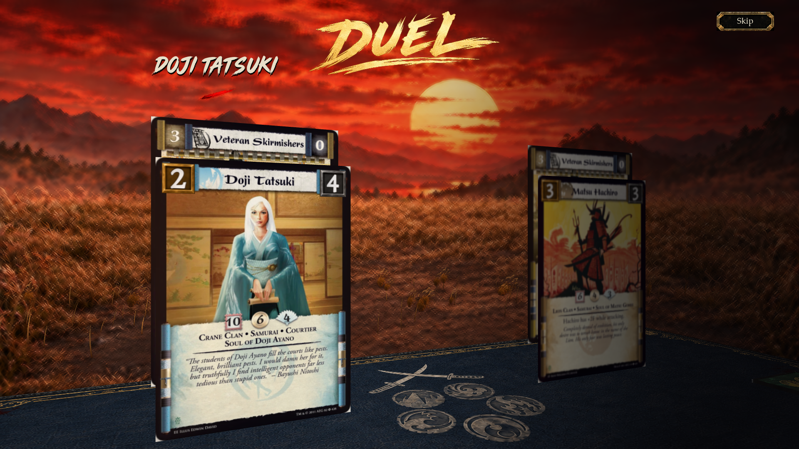
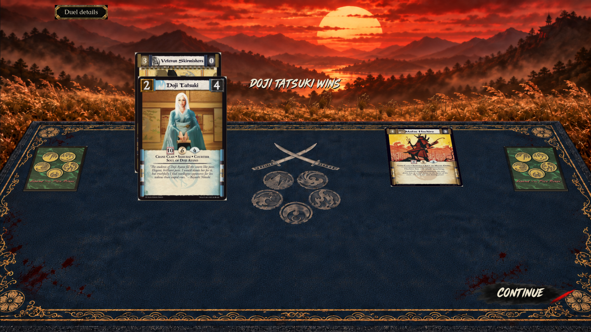

# Native atmosphere review

[Implementation, reproduction and limits](../../../DUEL_ATMOSPHERE.md) · [Validation](validation.json)

These are actual native Godot frames. The local 37.1-second 1080p/30 fps movie is `artifacts/duel-atmosphere/crimson-atmosphere.mp4`; it includes the full real seed-205 duel. Video capture is separate from real-time performance measurement.

The extra grass uses approved tuft art on segmented instanced geometry. Sky motion uses the approved painted backdrop. Human atmosphere acceptance remains open.
