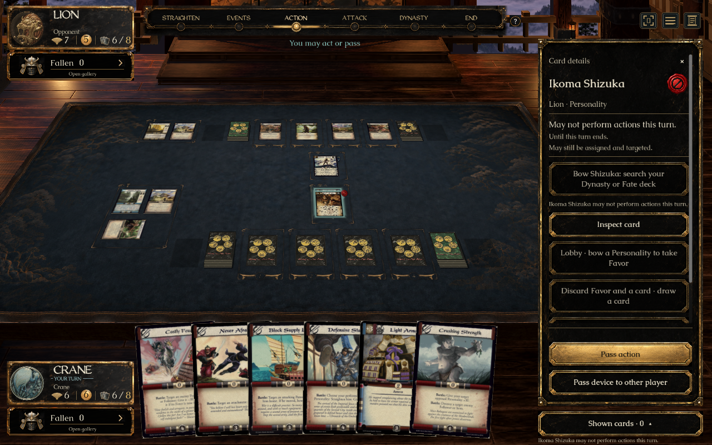
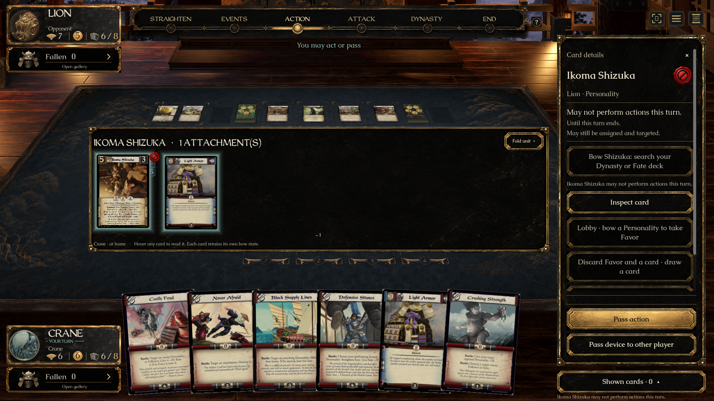
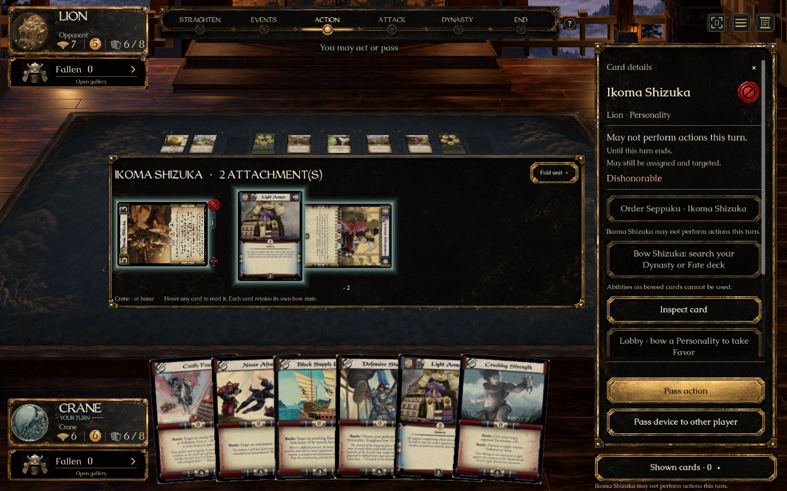

# Action restriction (#347) — ready for individual review

This is the third of eight approved UI previews. #339 and #315 are also available; five tasks remain. **No merge into main is authorized.** [PR #395](https://github.com/alfredoh7/l5r-emperor/pull/395) is a draft stacked on #393. UI acceptance and passing checks do not imply merge permission.

## Open the prepared demo

On Alfredo's Mac: [L5R Action Restriction — Review.app](../../artifacts/L5R%20Action%20Restriction%20-%20Review.app).

The launcher builds this checkout and opens a prepared match where Daigotsu Hotako's real published ability has restricted Ikoma Shizuka. The engine applies the restriction; the UI reads `CardView.ActionLocked`. The setup places published cards directly in play for a focused review, rather than playing a complete match to reach the position.

The portable checked-in entry point is `Review Action Restriction.command`. Recreate the generated Mac app in another checkout with:

```sh
python3 tools/create-review-launcher.py 'Review Action Restriction.command' 'L5R Action Restriction - Review'
```

The launcher neither fetches another branch nor merges main. Card scans use the already installed private `catalogue-art-ui-eight-20260921-r2` dependency.

## Short review checklist

1. Look for the small red prohibition seal just outside Shizuka's upper-right card edge. It stays clear of the printed statistics. Click the seal or card to inspect it; clicking the selected card again returns to the phase overview.
2. The inspector says **May not perform actions this turn**, gives the expiry, and notes that the Personality may still be assigned and targeted. Shizuka's actual ability is disabled, with the engine's reason visible beneath it.
3. **Inspect card** opens the complete scan; close it to return. Hovering the card also gives a large reading view with the same restriction explanation.
4. **Inspect attachment** shows Light Armor's inherited restriction and identifies its attached Personality. Folded stacks use one table seal on the Personality to keep the board sparse.
5. **Advance turn** passes through the real engine's remaining turn decisions. The seal and restriction text disappear when the new turn begins. This is a prepared demo control, not a new gameplay shortcut.
6. **Restart demo** restores the restricted position. The three demo controls above the table exist only in this review mode.

## Approved visual direction and implementation

- Implements A's vermilion seal, explicit restriction and expiry, disabled action reason and full-card inspection. It reuses the existing game sidebar and physical unit spread. [Side-by-side comparison](../../assets/ui/action-lock/comparison.html) and [approved source / imagegen prompt](../../assets/ui/action-lock/README.md) record the art workflow.
- The sprite is a transparent production derivative generated with the built-in imagegen tool from the approved A reference. Alpha is preserved; Godot imports it with mipmaps at a 256-pixel limit. It is not a manual vector approximation or an identical copy of the reference pixels.
- The marker follows the visible upper-right edge through bowing. A minimum projected size keeps it legible at normal table distance. Dishonor retains its separate lower-right marker. Attachments show their public restriction in inspection; the table uses one seal per restricted Personality.
- The inspector keeps the restriction and actual disabled action visible before longer card text. Full scans remain available through hover and **Inspect card**. Straightening restrictions, dishonor and granted changes remain visible when present.
- No rules, legality, command, server or hidden-state contract is changed. The UI reads only `ActionLocked` and existing `ActionOption.Enabled` / `Reason`. The wording about assignment and targeting follows Mendon's recorded rulings in `2026-09-19-hotako-yoshitada-predator-liuxeung.md`.

## Verified evidence

- Client compilation: zero warnings/errors. Godot import passed.
- `bash tools/check-action-lock-ui.sh`: native Mac 1920×1080 normal motion and 1280×800 reduced motion passed. Real Hotako activation, public status on the Personality and attachment, projected seal click without a game command, disabled ability, readable hover and popup bounds, both seats, turn expiry, crowded units, independent bowed attachments and a bowed/dishonorable Personality were exercised. Screenshots were inspected.
- `dotnet run --project tests/L5R.Core.Tests -- --filter action-lock`: **16/16 passed**, including assignment/targeting behavior, inherited attachment restrictions and turn expiry. No new Core behavior was introduced.
- Actual Mac `.app` launch verified through the desktop: prepared restriction state, full-card inspection, attachment inspection, **Advance turn** expiry and **Restart demo** all worked. The initial restricted state was left open for Alfredo.
- Source and native art were rendered side by side in the local comparison page and inspected at matching display width. This confirms the chosen seal/inspector direction, not exact full-screen equality: card identities, engine state and the game's established unit spread differ from the illustrative concept.
- #315's Mac, Windows and context/handoff CI checks passed on `4cf598e8`. #347's CI must be assessed on its own pushed revision; local native results are not a Windows graphical acceptance claim.







## Remaining acceptance

Alfredo's individual UI acceptance, Mendon's review and CI on this PR revision remain outstanding. Native Windows graphical play and an external two-machine match have not been performed. Five UI tasks remain in the batch.

The isolated preview stack contains main `0d694f02` and previously approved unmerged UI work. Its inherited stabilization rules candidates remain unapproved as described in the eight-task plan. Main and the root checkout were not modified. **Do not merge this preview without Alfredo's explicit go-ahead.**
