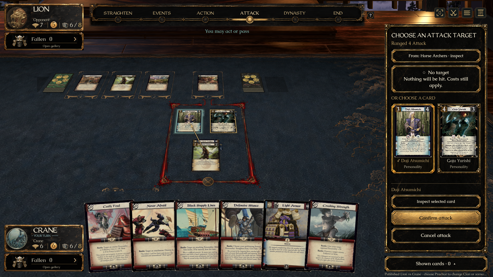
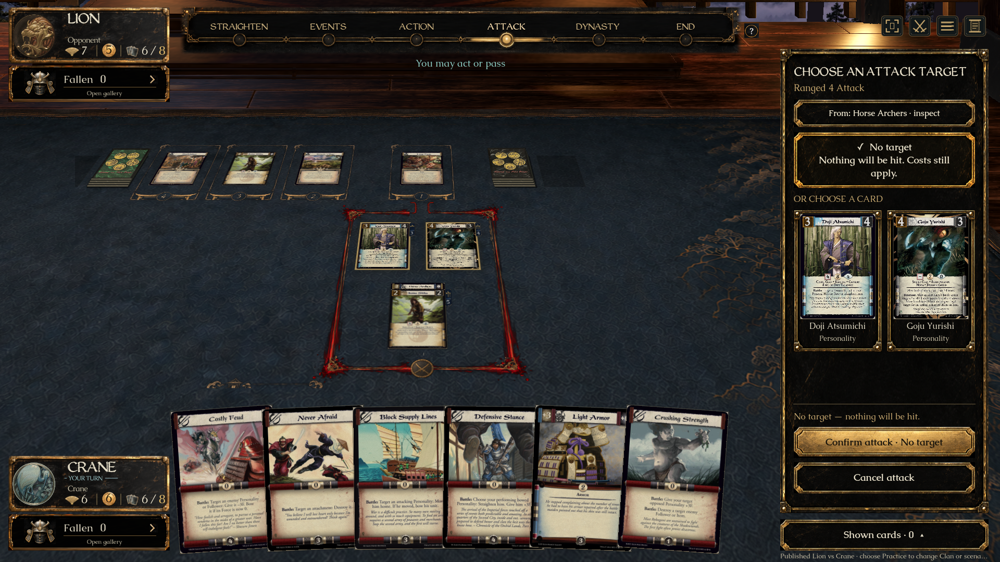
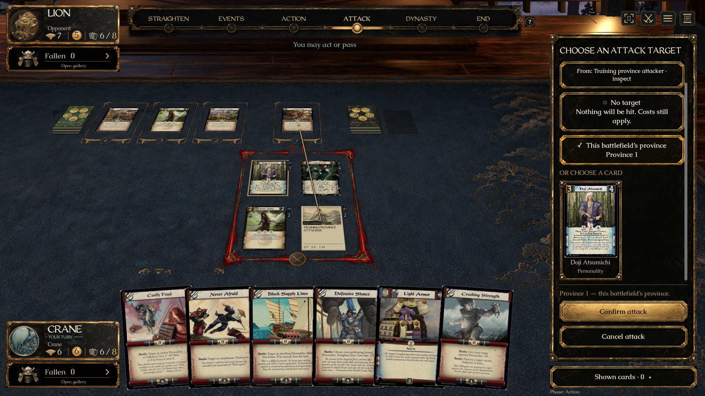
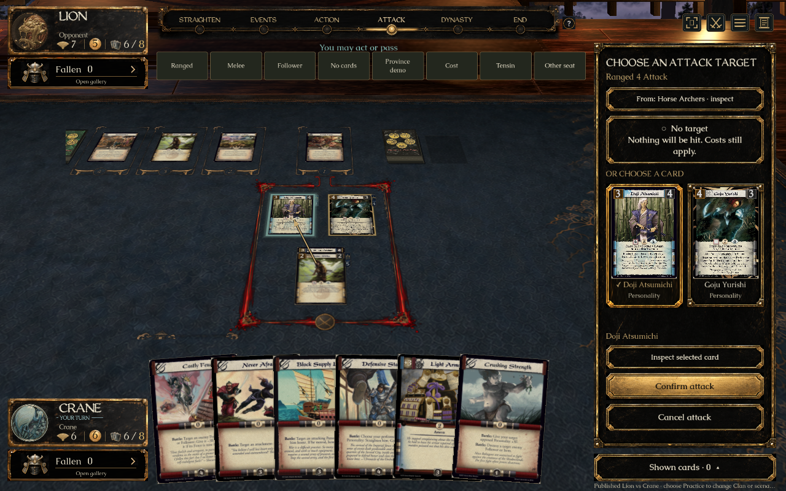

# Attack target choices (#355) — ready for individual review

Eighth approved UI preview: A’s explicit choices plus B’s full-card previews. [Draft PR #410](https://github.com/alfredoh7/l5r-emperor/pull/410) is stacked on #404. **No merge is authorized.** Completion delivers a review candidate, not human acceptance or merge permission.

## Open the prepared demo

On Alfredo’s Mac: [L5R Attack Targets — Review.app](../../artifacts/L5R%20Attack%20Targets%20-%20Review.app). Portable entry: `Review Attack Targets.command`.

The app builds this checkout and opens Horse Archers’ real Ranged Attack without a preselected target. Above-table controls prepare **Ranged**, **Melee**, **Follower**, **No cards**, **Province demo**, **Cost**, **Tensin**, and **Other seat**. They are review-only shortcuts to real engine decisions, not new gameplay actions. The province case explicitly uses the existing training definition; it is not added to playable decks. The other cases use published cards placed in the required zones. No fetch, branch change or merge occurs.

Recreate the local bundle with:

```sh
python3 tools/create-review-launcher.py 'Review Attack Targets.command' 'L5R Attack Targets - Review'
```

## Short review checklist

1. Start with **Ranged**. No option should be selected and confirmation should be disabled. Choose **No target**: the warning says nothing will be hit and costs still apply. No target arrow should remain.
2. Choose either full card face in the sidebar, or click a legal card on the table. The selection and table arrow should agree. **Inspect selected card** opens the complete scan; closing inspection preserves the unconfirmed choice. **From: Horse Archers · inspect** opens the source.
3. Switch among cards and **No target**, then **Cancel attack**. Selection must not execute the action. Restart Ranged and confirm Doji Atsumichi to hit him; target Goju Yurishi to see the engine’s card-targeted reaction window. Confirming No target must open no card-targeted window.
4. **Follower** offers the legal Follower rather than its protected host. **No cards** still permits No target. **Melee** uses the same explicit flow.
5. **Province demo** additionally offers **This battlefield’s province**. Select it in the sidebar or by clicking the current defending province on the table. The command names the province, not its Dynasty card. Switching back to a card clears the province choice. Confirming the province reduces its strength through the training ability.
6. **Cost** prepares Carpenter Castle’s Attack. Confirming No target still pays the real bow cost; it does not earn the card-target Honor benefit. Costs remain authoritative in the engine.
7. **Tensin** prepares the Attack performed by a Follower in his unit. Choose No target or a card, then confirm. The performing Follower bows only when the Attack is submitted. To review the other Follower, cancel, select Tensin and choose the action naming that Follower. This is a fixed bow cost; there is no alternative-cost step.
8. **Other seat** removes the unfinished choice. Returning requires a new explicit selection. Check keyboard selection, the smaller window and reduced motion; confirmation stays visible while the option list scrolls.

## Approved design and authority

[Art provenance](../../assets/ui/attack-targets/README.md) · [Source/native comparison](../../assets/ui/attack-targets/comparison.html) · [All eight review links](2026-09-21-eight-ui-review-index.md).

The existing lacquer atlas, full period scans and Caudex/WeatheredQuill implement the chosen combination. Real engine state and the established table replace the concepts’ illustrative cards/layout; whole-screen pixel identity is not claimed.

`NoTarget`, `TargetIds` and `Provinces` alone supply choices. All currently legal Attack abilities expose `NoTarget`; movement retains its separate `Movement` flow and is never classified from `Provinces` alone. Choosing an option sets mutually exclusive TargetId/Province fields, refreshes the engine’s quoted payment suggestions, and remains local until confirmation. Ordinary actions retain their existing target flow. No Core, server, printing or wire-format behavior is changed here.

The existing version/disconnection guards discard stale drafts; a seat change also removes this task’s selection. Full faces and inspection use public CardView data. Province arrows point at the battlefield’s province; no-target choices draw no arrow. Gold handling uses the existing shared panel; fixed non-Gold costs remain part of the engine action.

## Verified evidence

- Client compilation: **zero warnings/errors**. Godot import passed after one initial asset-import crash; the first crash log is retained under ignored `artifacts/checks/attack-targets/`. The exact initial crash cause was not established.
- `bash tools/check-attack-targets-ui.sh '1920x1080 normal' '1280x800 reduced' '1280x800 reduced-review-check'`: **all three passed**. Checks cover keyboard/sidebar/table input, explicit confirmation, retarget/cancel/seat reset, actual card hit, card-targeted reaction, legal Follower versus host, empty/Melee No target, province targeting/strength and real bow-cost/Honor behavior. Sidebar, confirmation and arrow bounds are checked.
- The first locked-desktop run failed the real focus guard, which was preserved. A separate renderer/controller path reports `ATTACK_TARGET_RENDER_PASS` only and does not count as native table-input acceptance. Full native runs subsequently passed after desktop access returned.
- Initial visual inspection found that the heading and full-card minimum widths pushed the sidebar past the window. Wrapped heading text and fitted card widths corrected it; both final sizes and review navigation were visually inspected.
- Existing Core targeted-action/reaction suite: **30/30 passed**. Client/transport suite: **11/11 passed**, including the new server-envelope/client projection and strict outgoing-command cases for No target, card and province. This is serialization/contract evidence, not an external multiplayer playtest.
- Final normal and reduced-review checks also passed Tensin’s fixed-cost Attack through either performing Follower, preserving No target/card choice and bowing only the selected performer on submission. The test selects the second engine offer through the controller, then exercises native target/confirmation input. The actual Mac launcher was reopened and Tensin’s review button, No target and confirmed bow cost were checked through desktop clicks. Internal performer IDs are omitted from the player-facing Attack label.
- Movement’s existing `1280x800 reduced-review-check` passed again on this combined implementation, covering the shared table/target routing, attachments, Hawado cost distinction and partial negation.
- The actual Mac `.app` launched directly to the prepared choice. Desktop clicks verified unconfirmed full-card selection, full-size inspection and return, No target clearing the card arrow, review navigation and actual table province selection. The game was then closed cleanly.
- All eight prepared Mac bundles were generated in this combined checkout and checked to point at their matching command here. The earlier seven actual launcher checks remain recorded in their task handoffs; Copy’s final desktop check was completed with Movement. The generic Latest launcher was refreshed.









## Coordination and remaining acceptance

Main was refreshed at `0d694f02`, with no missing main commits. The branch inherits the unmerged review stack through #404 and separately unapproved stabilization candidates documented in the batch plan. #388/#397/#399/#405/#407 affect neighboring shared state/action data; #409 is scan-request documentation only. Their independent changes are preserved. The existing Copy/#388 duplicate-panel integration note remains applicable.

`collab.py context` refreshed refs but could not complete live GitHub context; direct Git/GitHub CLI reads supplied the open-task and PR facts. The project-board token is unavailable. PR #404’s final context, Mac and Windows CI passed on `7e7d6999`; this PR’s checks must be read on its own final revision.

Alfredo’s UI acceptance, Mendon’s rules-presentation review, native Windows graphical play and external multiplayer acceptance remain open. Final-revision CI is tracked on PR #410. Root checkout and main are unchanged. **Do not merge without Alfredo’s explicit go-ahead.**
