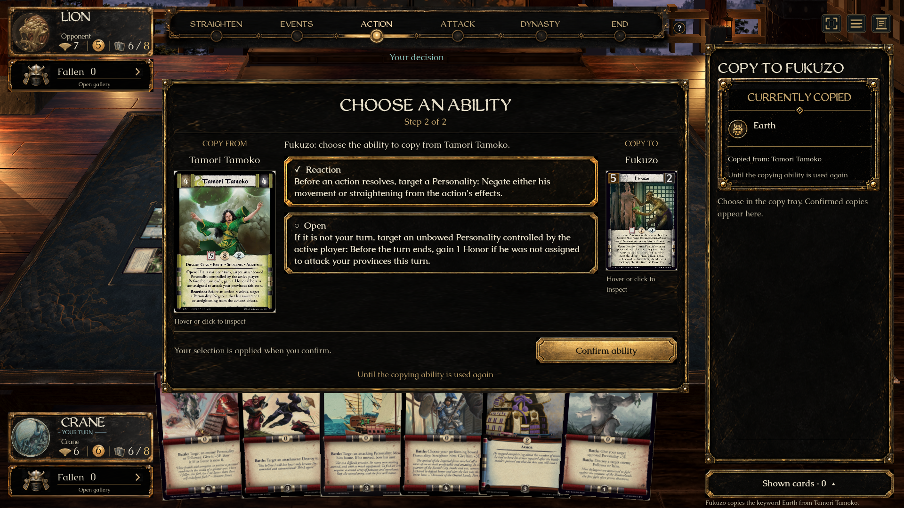
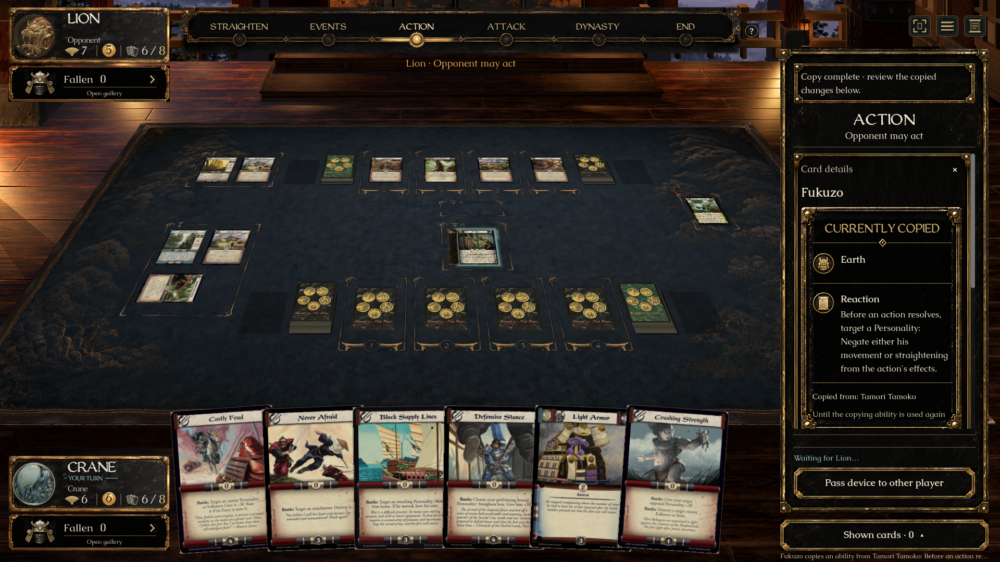
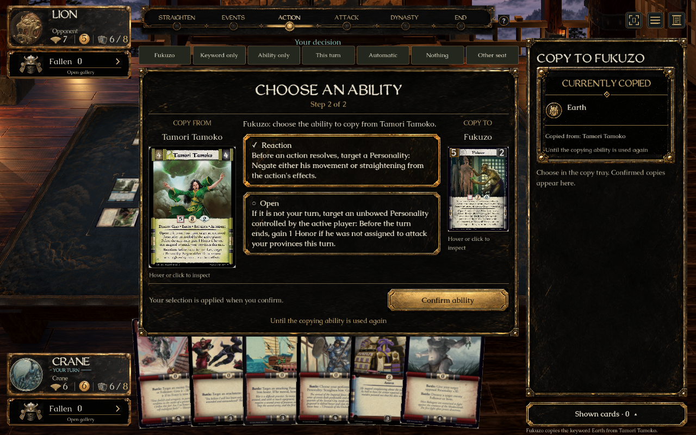
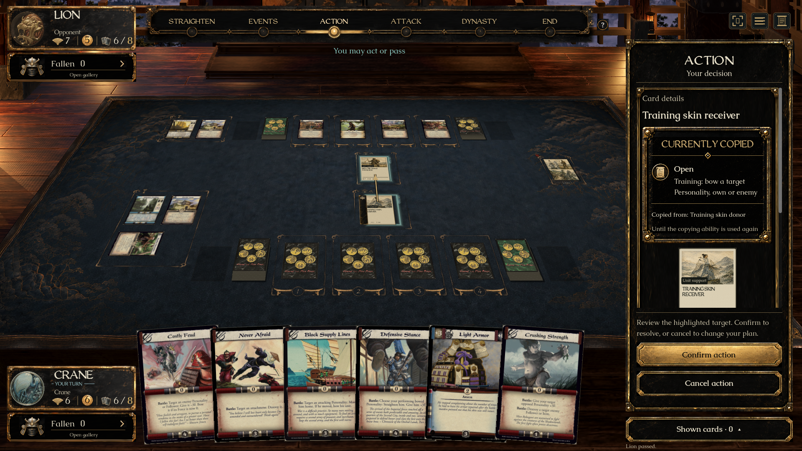

# Copy wizard (#342) — native checks passed; desktop launcher review pending

Sixth of eight approved UI previews. **No merge into main is authorized.** [PR #403](https://github.com/alfredoh7/l5r-emperor/pull/403) remains a draft stacked on #401. A completed implementation, passing checks and individual UI acceptance do not grant merge permission.

## Open the prepared demo

On Alfredo’s Mac: [L5R Copy — Review.app](../../artifacts/L5R%20Copy%20-%20Review.app).

The launcher builds this checkout and opens Fukuzo’s keyword decision. The controls above the table prepare **Fukuzo**, **Keyword only**, **Ability only**, **This turn**, **Automatic**, or **Nothing**; **Other seat** switches between chooser and waiting player. These controls only appear in review mode and do not fetch, switch branches or merge main.

Portable entry: `Review Copy.command`. Recreate the Mac app with:

```sh
python3 tools/create-review-launcher.py 'Review Copy.command' 'L5R Copy - Review'
```

The fixture puts Fukuzo and Tamori Tamoko on the published Lion/Crane test table, then uses Fukuzo’s real copy action and pays its donor-removal cost. Isolated keyword/ability, automatic and empty cases use explicitly named training definitions, not additions to playable decks. Artwork uses the installed private `catalogue-art-ui-eight-20260921-r2` dependency.

**Launcher verification limit:** the app bundle and command are prepared, and the native review-mode controls pass automated graphical/input checks. The desktop click-through of the actual `.app` is still pending: Computer Use reported that the Mac was locked. Alfredo was asked to unlock it. Do not claim that this final launcher step passed.

## Short review checklist

1. **Fukuzo:** inspect the full source and receiver faces. Choose a keyword, then confirm. Choosing alone must not resolve the decision. The confirmed keyword appears in **Currently copied** while the tray advances to the ability step.
2. Choose an ability: read its timing and full engine text, then confirm separately. The tray closes. The recipient’s summary shows keyword, ability, source and duration; their shared duration is stated once. The small on-card change marker opens the same information by hover or keyboard focus.
3. **Other seat:** the waiting player sees a waiting message without the chooser’s options. Returning to the chooser requires a fresh selection. Confirmed choices remain applied.
4. **Keyword only / Ability only:** only the required independent step appears. With **Ability only**, copy the training bow action. Let the opposing player pass, then select the receiving card and use its normal copied action. Choose the opposing Personality and confirm. Hover the disabled action afterward for the engine’s spent/unavailable reason.
5. **This turn:** copy a training ability and verify the duration says **Until turn ends** rather than the next-use duration.
6. **Automatic / Nothing:** one candidate applies automatically; no candidates skips the step. There is no artificial choice to confirm. Inspect the recipient and read the visible result or skipped-step announcement; full event text remains in the match log.
7. Keyboard Tab/Enter selects options; confirmation is a separate button. Hover or click either card to inspect its full scan. Escape closes inspection. Check the tray at a smaller window size and with reduced motion.

## Approved direction and authority

[Art provenance](../../assets/ui/copy-wizard/README.md) · [Source/native comparison](../../assets/ui/copy-wizard/comparison.html).

Uses B’s central tray with A’s compact result summary, the existing lacquer atlas, full period scans and Caudex/WeatheredQuill typography. The existing permanent-grants panel/seal is shared by copied changes. Real engine state replaces the concept’s illustrative faces and simultaneous-state montage. This is a faithful combined direction, not a claim of identical whole-screen pixels.

`PendingCopy` supplies source/receiver, independent current step, remaining steps, available values/text and duration. The UI submits the offered complete command only after confirmation. It never decides copy eligibility, costs, restrictions or lifecycle. The source scan comes from the authorized public definition ID; no hidden instance is queried. Current copied grants come from public card views. Ordinary copied actions retain engine legality and reasons. No Core, server, printing or wire-format changes are introduced.

Selection clears when readiness, version, match or seat changes. Opponent/snapshot-loss paths remove chooser content. Observed multi-step progress is retained within that choice; joining or returning only at the last step says **Final step**, because the view does not expose an original step count. Zero/single candidates are handled by the engine and its public events. The copy tray blocks table-camera input while open.

## Verified evidence

- Client compilation: **zero warnings/errors**. Godot import passed.
- `bash tools/check-copy-ui.sh`: **1920×1080 normal** and **1280×800 reduced motion** passed. Native checks cover independent/composed steps, no preselection, source hover, keyboard selection, separate confirmation, busy/seat resets, waiting privacy, real stored keyword/ability, provenance/duration, on-card marker focus, copied action activation and spent reason, turn duration, automatic and skipped steps.
- `bash tools/check-copy-ui.sh '1280x800 reduced-review-check'`: passed with actual demo navigation present. Checks navigation bounds and both seat switches, then the complete flow above.
- Existing `dotnet run --project tests/L5R.Core.Tests -- --filter card-copy`: **15/15 passed**. Includes privacy, autoskip, replacement/lifecycle, copied Reaction execution and replay.
- Existing `dotnet run --project tests/L5R.Client.Transport.Tests`: **9/9 passed**. These are general transport checks, not a new Copy-specific live transport or external multiplayer test.
- Existing `PermanentGrantProbe` at **1280×720 small** and **1920×1080 long**, plus `TokenRailProbe --bowed-attachments` at **1920×1080**, passed. Shared seal/card-effects changes preserve permanent/timed distinctions, source names, keyboard/hover inspection, token grouping and attachment ownership.
- Native screenshots were inspected, including small-window review navigation, completed summary, marker, activation and the shared permanent-grants display. Approved concepts and native images were viewed side by side through the comparison page.
- The first native run exposed a test-fixture error: selecting an already selected recipient toggled inspection off. The fixture now preserves the existing selection and explicitly targets the opposing Personality when testing the copied bow action. Subsequent native checks passed.
- Final ref refresh kept main at `0d694f02` with no commits missing from this branch. `collab.py context` hit a null PR-files response; direct Git/GitHub reads confirmed the same open overlaps. `collab.py audit --working` passed with no errors. #401’s final context, Mac and Windows CI passed on `e0d1d66d`.
- Full source/receiver faces now initialize their requested height even when Godot does not issue a later resize. Copied actions appear beside their summary before the printed scan; they still use the ordinary engine action controls.









## Coordination and remaining work

#388 adds a standalone granted-ability listing and new authoritative source/usage fields not yet on main. This preview includes existing `GrantedAbilities` in the shared `CardChanges` panel. During later integration, remove or restrict #388’s duplicate standalone listing while preserving its additional metadata. This overlap was recorded on #388; its engine changes are not imported here. #397/#399 do not edit this UI. The inherited UI stack and stabilization rules candidates remain separately unapproved as recorded in the eight-task plan.

Final desktop launcher click-through, Alfredo’s individual UI acceptance, Mendon’s rules-presentation review and CI on the final revision remain open. Native Windows graphical play and external multiplayer are not claimed. The project-board token is unavailable; GitHub ownership is recorded explicitly. Two other UI implementations remain: #346 Movement and #355 Attack targets. Root checkout/main remain unchanged. **Do not merge without Alfredo’s explicit go-ahead.**
