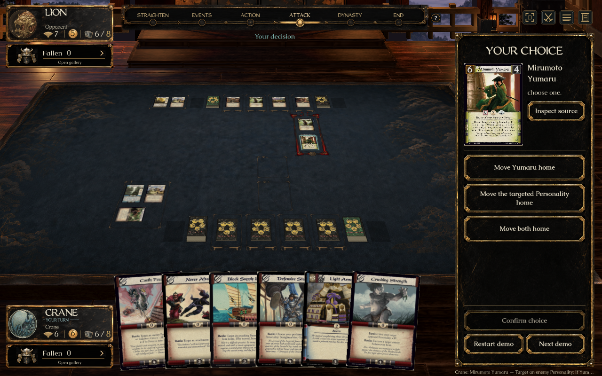
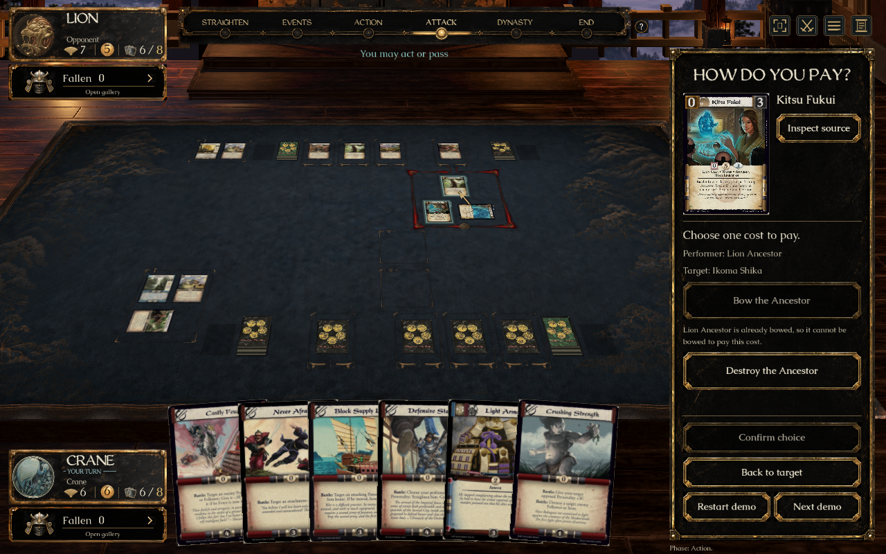

# Decision chooser (#339) — ready for individual review

This is **1 of 8** approved UI previews. **No merge into main is authorized.** PR [#392](https://github.com/alfredoh7/l5r-emperor/pull/392) remains a draft against the isolated `codex/ui-eight-preview-base`; the other seven tasks remain pending. Test success and human acceptance do not authorize a merge.

## Open the prepared demo

On Alfredo's Mac: [L5R Decision Chooser — Review.app](../../artifacts/L5R%20Decision%20Chooser%20-%20Review.app).

The local app is generated, not checked into Git. On another Mac checkout, run:

```sh
python3 tools/create-review-launcher.py 'Review Decision Chooser.command' 'L5R Decision Chooser - Review'
```

Or open the checked-in `Review Decision Chooser.command`. This builds this review checkout, verifies the artwork dependency, then opens the prepared Yumaru choice. It never fetches another branch or merges main. The artwork is installed locally for offline launches; the private dependency is [catalogue-art-ui-eight-20260921](https://github.com/alfredoh7/l5r-emperor/releases/tag/catalogue-art-ui-eight-20260921).

## Short review checklist

1. **Yumaru:** the sidebar should immediately show all three movement choices, with none selected. Select an option; the board must wait until **Confirm choice**. Use **Restart demo** to try the other outcomes. Keyboard focus and Enter also select an option before confirmation.
2. **Source inspection:** **Inspect source** opens the complete card; closing it must leave the decision pending. The source is highlighted on the table.
3. **Next demo → Fukui:** review the performing Ancestor and target, then choose **Review cost choices**. Either bow or destroy the Ancestor; select and confirm. Restart to try the other cost. **Back to target** clears the draft cost.
4. **Next demo → bowed Ancestor:** bowing should be disabled with its explanation; destruction remains available. The created Ancestor is removed from the game when destroyed, as required by the current engine.
5. **Next demo** returns to Yumaru. Review controls are confined to this demo mode.

## Implementation and approved visual direction

- A's automatic sidebar with B's full source-card preview and full-size inspection, using the existing approved lacquer assets, Caudex and WeatheredQuill. Reference concepts are the parent checkout's `artifacts/ui-eight-design-review-2026-09-20/images/01-decisions-a.png` and `01-decisions-b.png`.
- The native captures below were inspected against those references. The compact source row, verified period scans and live game layout replace illustrative generated card art; no claim of exact full-screen pixel equivalence is made.
- Engine-listed answers for effectChoice, preservingHonor, rinShame, conqueror, declineStraighten and forcedDiscard appear independently of card selection. Times of Strife retains its dedicated presentation.
- Explicit selection before confirmation, disabled reasons, keyboard controls, source inspection and opponent waiting. Pending answers submit the engine's complete command unchanged.
- Alternative costs group by source, ability and performer. Target selection precedes “How do you pay?”. Gold, when quoted, continues through the existing payment panel.
- Additive `AlternativeCostView` metadata retains grouping and labels for disabled options whose Command is null. The UI does not invent commands or determine legality. Mendon's review is requested for this shared contract and the prepared fixtures.
- Yumaru and Fukui use real published abilities. Other generic fixtures exercise engine choices; the Conqueror grant, choose-straighten test definition and prepared forced-discard queue are scenario setup, not proof of a complete published-card trigger chain.

## Verified evidence

- `bash tools/check.sh --skip-client`: all requested deterministic checks passed (`artifacts/decision-full-check.log`), including 34/34 AI, 8/8 server and 8/8 transport. This run preceded the final presentation-only compact footer refinement and expanded generic fixtures.
- Expanded focused showcase checks: 3/3 passed (`artifacts/decision-fixtures.log`), covering all three Yumaru consequences, stale-command rejection, opponent privacy, disabled-cost metadata serialization and all five additional generic decision types. Earlier focused suites: 16/16 alternative-cost and 10/10 effect-choice passed.
- Final client build: zero warnings/errors; Godot headless import passed.
- Native Mac: all three Yumaru outcomes, Fukui destruction and bow payments, bowed-option reason, opponent waiting, all five other generic types, explicit confirmation and reduced motion passed. Resolutions exercised: 1920×1080 and 1280×800.
- Final compact demo check: all option buttons fully inside the visible scroll area; restart, next-demo cycle and clearing the draft via Back all passed (`artifacts/checks/decisions/review-check.log`). Both final source-row compact cases and the bow-payment follow-up passed.
- Actual `.app` launch verified through the Mac UI: it builds and opens the prepared Yumaru decision. Full source inspection and demo navigation were also checked in the native window.
- Updated artwork dependency: 2,895 verified scans, private prerelease asset uploaded; offline installation verified. Bulk artwork stays out of Git.





## Boundaries and remaining review

The preview baseline integrates main `20708c37` with the approved UI lineage, on `codex/ui-eight-preview-base` (`59437b01`). Its inherited stabilization rules candidates remain unapproved; see the eight-task review plan. Main and the root checkout were not modified.

The PR uses a preview base; the current GitHub routing check is skipped, and normal main-target CI has not run. Local results above are not a CI-pass claim. A multiplayer reconnect session, native Windows graphical play and expert rules acceptance have not been performed for this preview. Alfredo's individual UI acceptance and Mendon's shared-contract review remain outstanding. **No merge permission has been granted.**
