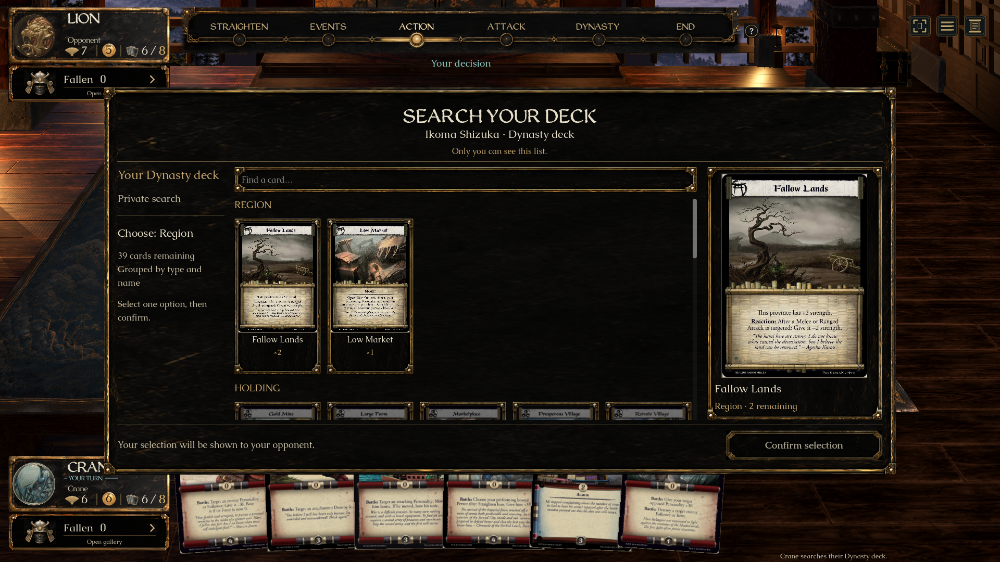
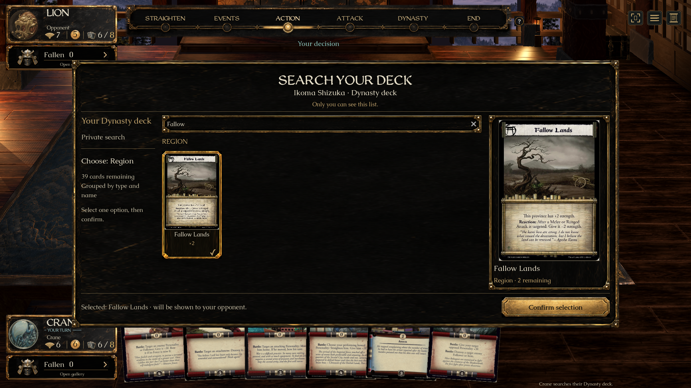
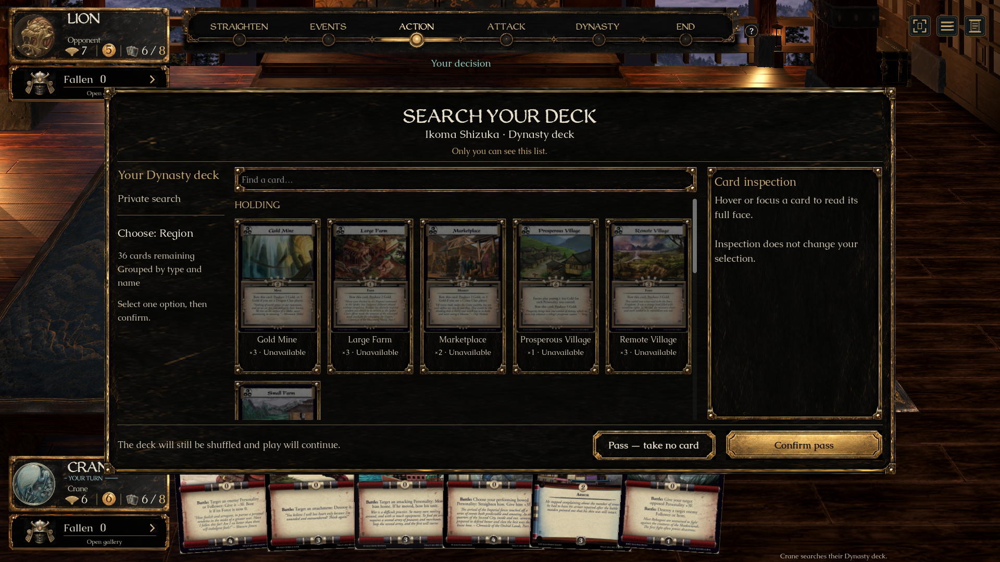
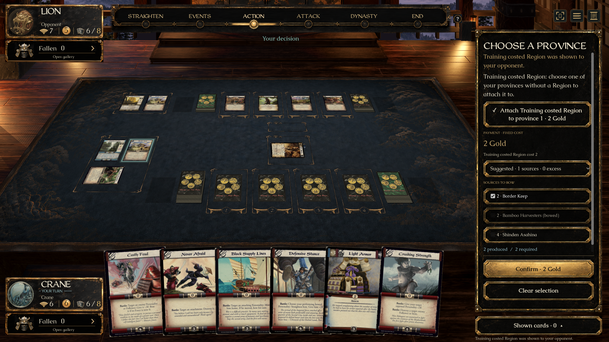

# Deck search (#314) — ready for individual review

Fourth of eight approved UI previews. **No merge into main is authorized.** [PR #396](https://github.com/alfredoh7/l5r-emperor/pull/396) is a draft stacked on #395. Completion means a tested review candidate; UI acceptance and passing checks do not grant merge permission.

## Open the prepared demo

On Alfredo’s Mac: [L5R Deck Search — Review.app](../../artifacts/L5R%20Deck%20Search%20-%20Review.app).

The launcher builds this checkout and opens Ikoma Shizuka’s real engine search at the deck-choice step. Review controls above the panel restart Shizuka, prepare Imperial Gift, prepare a no-eligible-card search, or switch seats. They exist only in this prepared review mode. The fixture places cards directly into the relevant zones to reach these decisions without playing a whole match. Ordinary gameplay still follows the engine’s full turn/action rules.

Portable entry point: `Review Deck Search.command`. Recreate the generated Mac app with:

```sh
python3 tools/create-review-launcher.py 'Review Deck Search.command' 'L5R Deck Search - Review'
```

The launcher neither fetches another branch nor merges main. Artwork uses the installed private `catalogue-art-ui-eight-20260921-r2` dependency.

## Short review checklist

1. Select Dynasty or Fate and confirm. The source’s full scan is available during deck selection; neither deck’s contents appear before confirmation.
2. Read the private-search note. Candidates are grouped by card/type with counts; eligible type groups appear first. Scroll or type in **Find a card**. The list never represents deck order.
3. Hover or keyboard-focus cards to inspect their complete scan inside the panel. Ineligible cards are dim and marked unavailable; their engine-provided reason appears in inspection. Clicking one does not select it.
4. Select an eligible card. Its border/check and the footer identify the pending choice. Nothing is submitted until **Confirm selection**. The selected card is then publicly shown.
5. Dynasty leads to a province choice for the Region. Fate leads to the engine’s hand-discard choice. Select and explicitly confirm the follow-up. The found Terrain is excluded from its own discard candidates by the engine.
6. Choose **No eligible cards**, then Dynasty. **Pass — take no card** stays visible in the fixed footer. Confirm Pass; the deck still shuffles and play continues. Mandatory searches with an eligible card have no Pass.
7. Choose **Imperial Gift**. Its Fate/Item search opens directly. Confirm an Item to finish the Event; the engine handles Honor, the hand, shuffling and the province refill.
8. **View other seat** removes the private gallery. Only the public search prompt and deliberate shown-card history are available. Switch back to return to the pending decision with a fresh selection.

## Approved direction and boundaries

[Concepts and artwork provenance](../../assets/ui/deck-search/README.md) · [Source/native comparison](../../assets/ui/deck-search/comparison.html).

Uses B’s full-card gallery inside A’s panel, context column, private note and internal inspection. Reuses the approved lacquer atlas and existing Caudex/WeatheredQuill fonts; real period scans replace illustrative concept faces. Full card faces and printed statistics remain clear. Comparison verifies this combined direction, not identical whole-screen pixels.

All candidates, eligibility, reasons, deck choices, Pass availability and commands come from `MatchView.PendingSearch` / `ActionOption`. The UI has no hidden deck-instance lookup and computes no eligibility. The existing quoted Gold panel handles costed Region follow-ups. After choosing a province or discard, the sidebar shows the chosen option and confirmation details together; Clear selection returns to all choices. No Core, server, card definition or wire format changes are introduced. The gallery disappears on seat/view change or loss of the snapshot; changed version/session/readiness resets local selection. Inspection and filtering submit no game command.

## Verified evidence

- Client compilation: zero warnings/errors; Godot import passed.
- `bash tools/check-deck-search-ui.sh`: native Mac 1920×1080 normal motion and 1280×800 reduced motion passed. Covers deck choice, explicit card confirmation, duplicate counts, full-card mouse/keyboard inspection, ineligible reasons, real text input, gallery wheel without table zoom, both seats, selection reset while busy, Region placement, Terrain discard, no-match/empty/optional Pass, Imperial Gift, and engine-quoted Region payment. Empty/optional/costed cases include explicitly labeled engine training fixtures only in the automated harness.
- `dotnet run --project tests/L5R.Core.Tests -- --filter deck-search`: **23/23 passed**. This checks the existing engine contract, including privacy, mandatory/optional choices, payment, shuffle and follow-up behavior.
- `dotnet run --project tests/L5R.Client.Transport.Tests`: **9/9 passed**, including search payload/command deserialization and live shown-history/reconnect privacy. This is local transport evidence, not an external two-machine graphical match.
- The actual Mac app launcher opened the prepared deck choice. Desktop clicks verified selection/confirmation, the gallery, real keyboard filtering and removal/restoration of the private list when switching seats.
- Source and native captures were rendered side by side at equal display width in the comparison page and inspected. Native screenshots include the gallery, selected card, fixed Pass footer and payment follow-up.
- Current main remains `0d694f02`. Open #388’s two inspector additions were inspected; they affect granted-ability description and do not overlap this task’s early search dispatch. Its new rules contract is not included in this preview. #347’s context, Mac and Windows CI passed on its own revision.









## Remaining acceptance

Alfredo’s UI acceptance, Mendon’s review, and CI on this PR revision remain outstanding. Native Windows graphical play and external multiplayer acceptance have not been performed. Four UI tasks remain: #343 Either/Or, #342 Copy, #346 Movement and #355 Attack targets.

The isolated preview stack includes current main plus previously unmerged UI work. Inherited stabilization rules candidates remain unapproved, as described in the eight-task plan. Root checkout and main are unchanged. **Do not merge without Alfredo’s explicit go-ahead.**
