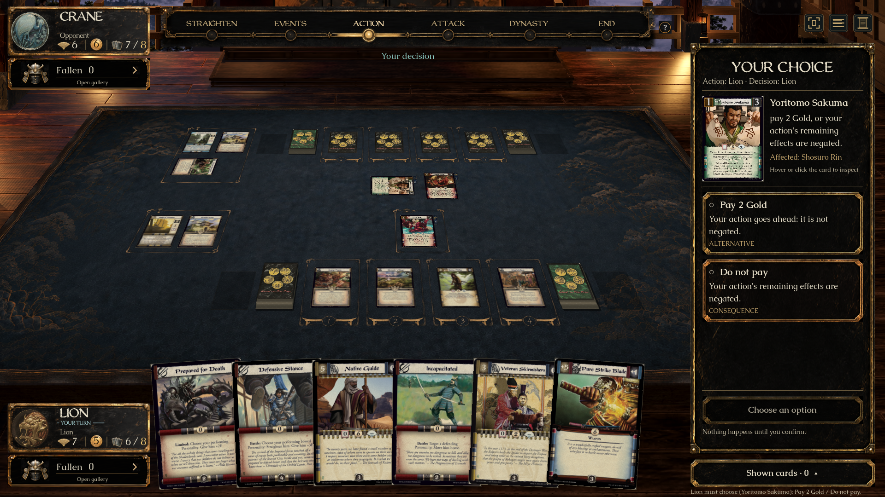
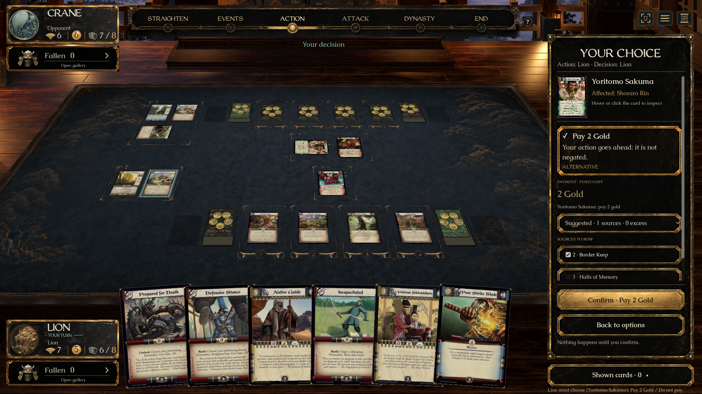
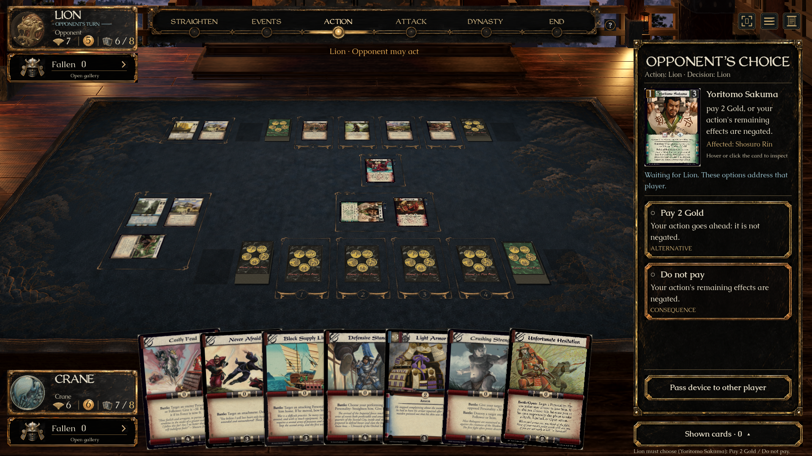
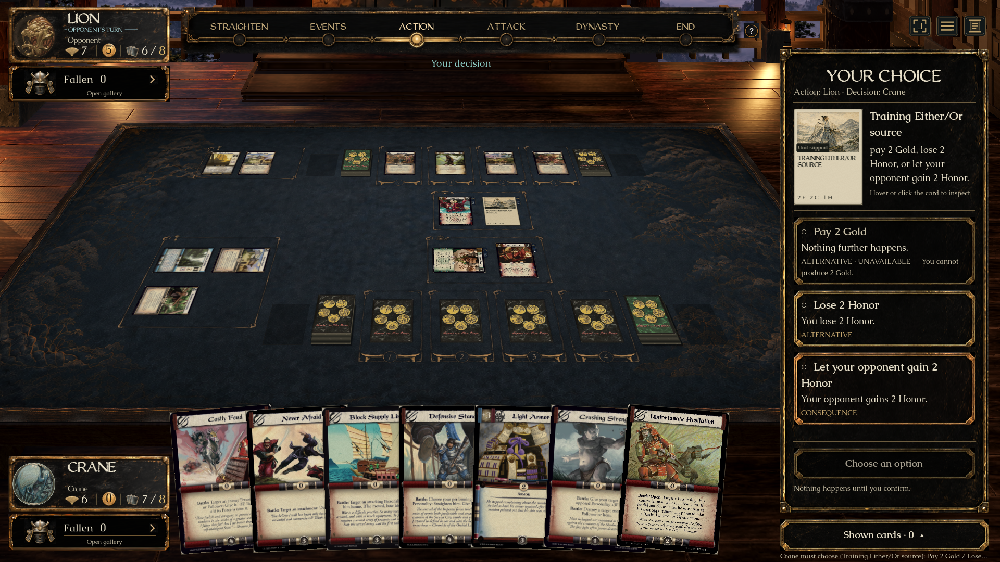
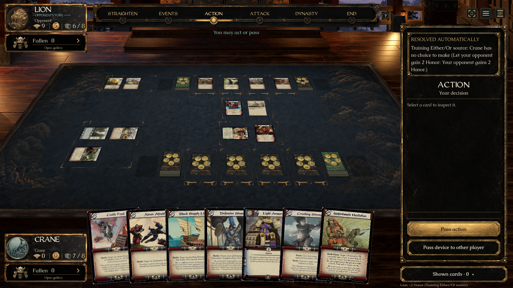

# Either/Or (#343) — ready for individual review

Fifth of eight approved UI previews. **No merge into main is authorized.** [PR #401](https://github.com/alfredoh7/l5r-emperor/pull/401) is a draft stacked on #396. Completion means a tested review candidate; UI acceptance and passing checks do not grant merge permission.

## Open the prepared demo

On Alfredo’s Mac: [L5R Either Or — Review.app](../../artifacts/L5R%20Either%20Or%20-%20Review.app).

The launcher builds this checkout and opens Yoritomo Sakuma’s real pending choice. Controls above the table prepare Sakuma, Unfortunate Hesitation, three options, an unavailable option, or an automatic result; **Other seat** switches between decider and waiting player. These controls exist only in this review mode and fit beside the sidebar in narrow windows. They neither fetch branches nor merge main.

The fixture puts published source cards on the Lion/Crane test table and executes their actual engine actions to reach the decision. Three-option, unavailable and automatic examples use the explicitly named training Either/Or source; it is not added to playable decks. This skips ordinary match setup, not the action/choice rules. Artwork uses the installed private `catalogue-art-ui-eight-20260921-r2` dependency.

Portable entry: `Review Either Or.command`. Recreate the Mac app with:

```sh
python3 tools/create-review-launcher.py 'Review Either Or.command' 'L5R Either Or - Review'
```

## Short review checklist

1. **Sakuma:** read whose action is in progress, who decides, and the affected Personality. Hover the source for its complete scan, or click/keyboard-activate it to keep inspection open. Escape returns to the choice. Nothing is preselected.
2. Select **Pay 2 Gold**. Its consequence remains visible while the existing payment panel shows the engine’s suggested sources and alternatives. Uncheck a required source to disable confirmation; choose valid sources and confirm once. **Back to options** cancels the draft without paying.
3. Restart Sakuma and choose **Do not pay**. Read the negation consequence before confirming. Either branch returns to the interrupted reaction window; pass reactions for both players to finish the original action. The paid branch applies Yogo Adi’s province-strength effect; the negated branch does not.
4. **Other seat:** both public options and consequences remain visible, with an explicit waiting message. No payment sources or confirmation appear. Returning to the decider requires a fresh selection.
5. **Three options / Unavailable:** compare Gold, Honor and accepting the consequence. The unavailable Gold option remains visible with its engine-provided reason. Keyboard focus/Enter selects an available option; confirmation remains a separate step.
6. **Hesitation:** choose whether to bow Yogo Adi or accept the required pass. The engine’s complete consequence is shown before confirmation.
7. **Automatic:** only one free option remains legal. No choice panel appears; a visible **Resolved automatically** explanation appears above the ordinary action sidebar for both seats. It remains until the next game-state change, and the event stays in the match log.

## Approved direction and authority

[Art provenance](../../assets/ui/either-or/README.md) · [Source/native comparison](../../assets/ui/either-or/comparison.html).

Uses A’s sidebar and source face with B’s explicit consequences, the established lacquer atlas and Caudex/WeatheredQuill typography. Full period scans replace illustrative concept faces. Waiting and payment states appear when relevant, rather than simultaneously as in the concept montage. This matches the approved combined direction, not identical whole-screen pixels.

The UI reads `PendingEitherOr` and the current `ActionOption` commands. Labels, consequences, option kinds, legality, reasons and Gold quotes come from the engine. It neither computes new rules/prices nor looks up hidden instances. The general option component supports any number of engine-listed options; public source inspection is reusable by later decision panels. Selection resets on match, version, seat or readiness changes and snapshot loss. The existing payment panel and explicit confirmation remain authoritative submission boundaries. No Core, server, card definition or wire format changes are introduced.

## Verified evidence

- Client compilation: zero warnings/errors. Godot import passed.
- `bash tools/check-either-or-ui.sh`: native Mac 1920×1080 normal motion and 1280×800 reduced motion passed. Covers source hover, keyboard selection, no preselection, separate confirmation, short payment, stale/busy/seat reset, waiting privacy, payment and negation with reaction-window resumption and actual resulting effects, three options, disabled reason, Honor, bow/pass and automatic announcements for both seats.
- `bash tools/check-either-or-ui.sh '1280x800 reduced-review-check'`: passed with actual review navigation present, checking bounds and switching both seats. This followed correction of a narrow-window overlap found in the launcher.
- `dotnet run --project tests/L5R.Core.Tests -- --filter either-or`: **17/17 passed**. Existing rules/JSON privacy, cost/negation, forced-pass and auto-resolution coverage; no new rule interpretation is claimed.
- `dotnet run --project tests/L5R.Client.Transport.Tests`: **9/9 passed**. These are the existing transport checks; the native Either/Or cases are local practice, not an external multiplayer playtest.
- The actual Mac app opened the prepared Sakuma decision. Desktop input checked full-card inspection/Escape, selecting payment without submission, and disabling confirmation when a required source was unchecked. The corrected launcher was reopened; desktop clicks verified the waiting seat, automatic result and return to Sakuma, with navigation clear of the sidebar. Native normal/reduced screenshots and the source/native comparison were visually inspected.
- Main remained `0d694f02` at final refresh. #388’s granted-ability text additions were inspected and do not replace this task’s tooltip hint or early decision dispatch. #397/#399 change rules/data rather than this choice UI. #396 context, Mac and Windows CI passed on revision `36c80b59`.
- The final `collab.py context` hit a null PR-files response; direct Git/GitHub CLI reads supplied live refs and open-PR checks. The project-board token is unavailable; GitHub ownership is recorded explicitly.











## Remaining acceptance

Alfredo’s individual UI acceptance, Mendon’s rules-presentation review, and CI on the final PR revision remain outstanding. Native Windows graphical play and external multiplayer acceptance have not been performed. Three UI tasks remain: #342 Copy, #346 Movement and #355 Attack targets.

The isolated preview stack includes current main plus previously unmerged UI work. Inherited stabilization rules candidates remain unapproved as recorded in the eight-task plan. Root checkout and main are unchanged. **Do not merge without Alfredo’s explicit go-ahead.**
