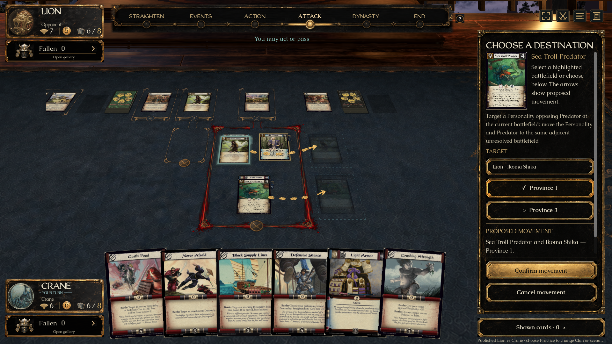
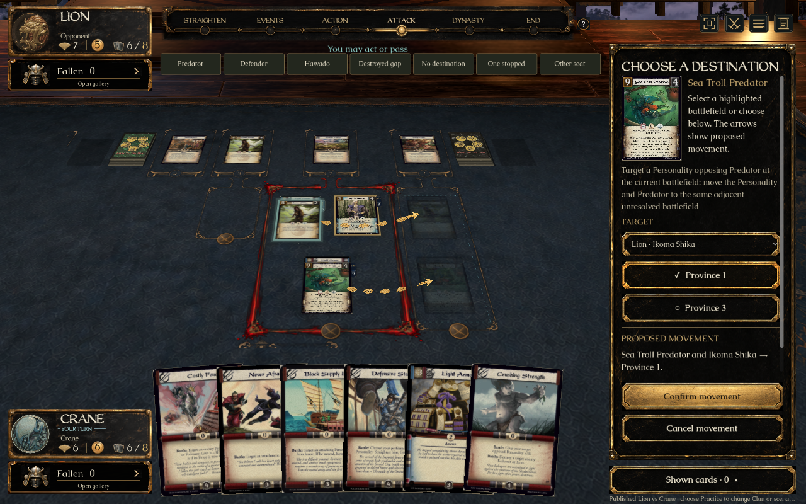
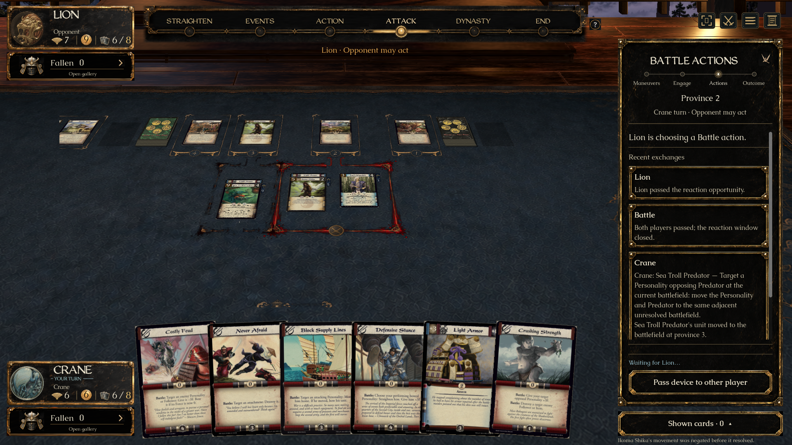

# Movement destination picker (#346) — ready for individual review

Seventh approved UI preview. [Draft PR #404](https://github.com/alfredoh7/l5r-emperor/pull/404) is stacked on #403. **No merge into main is authorized.** Completion and passing checks deliver a review candidate; neither concept approval nor individual UI acceptance silently grants merge permission.

## Open the prepared demo

On Alfredo’s Mac: [L5R Movement — Review.app](../../artifacts/L5R%20Movement%20-%20Review.app). Portable checkout entry: `Review Movement.command`.

The app builds its own checkout and opens a real Sea Troll Predator destination choice. The buttons above the table prepare **Predator**, **Defender**, **Hawado**, **Destroyed gap**, **No destination**, **One stopped**, and **Other seat**. They appear only in review mode. No fetch, branch switch or merge is performed. Recreate the app with:

```sh
python3 tools/create-review-launcher.py 'Review Movement.command' 'L5R Movement - Review'
```

The prepared published-card fixtures use the installed private `catalogue-art-ui-eight-20260921-r2` art dependency. The pinned playable deck profile and period printings are unchanged.

## Short review checklist

1. **Predator:** choose Province 1 or 3 in the sidebar or on the table. Each proposed mover gets its own familiar assignment arrow and translucent attachment stack. The real units remain in Province 2 until **Confirm movement**. Changing the target moves its preview arrow; **Cancel movement** removes the entire draft.
2. Click the full source face to inspect the original scan and rules text. The dialog closes without losing the destination. Keyboard selection still needs a separate confirmation.
3. Confirm a destination: both units and their Items arrive there. There is no “stay at home” alternative for this required movement.
4. **Hawado:** choose between the engine’s listed enemy battlefields. Only Hawado has a movement arrow. The targeted Dynasty discard pays the removal cost; it is never drawn as a moving unit. Confirmation moves and straightens Hawado and removes that cost card.
5. **Destroyed gap:** Province 3 is destroyed. Province 4 is a legal neighbor of Province 2 because the engine defines adjacency along the defender’s surviving province line. The UI keeps the original province indices/positions.
6. **Defender:** the acting card belongs to the defender. The legal destinations still use the defender’s province line. **No destination** shows the disabled action and engine reason instead of offering an invalid destination.
7. **One stopped** prepares a resolved example: Predator and its Item arrive in Province 3; Tamori Tamoko’s reaction prevents the target and its Item from leaving Province 2. The public log records the movement and negation separately.
8. **Other seat:** a pending local movement draft disappears. Returning requires a fresh choice. Try a smaller window and reduced motion; arrows/confirmation must stay visible.

## Implementation and authority

A’s sidebar, explicit destinations and proposed summary use the existing lacquer atlas and full period scans. The existing battle arrow textures, court geometry and translucent stack footprints are reused, as Alfredo requested. [Art provenance](../../assets/ui/movement/README.md) and [source/native comparison](../../assets/ui/movement/comparison.html) record the differences from the illustrative concept. Whole-screen pixel identity is not claimed.

`ActionOption.Movement` adds optional engine-projected defending owner, fixed source/performer movers and whether the chosen target also moves. Hawado’s already-validated destination commands now populate `Provinces`. The UI never recognizes card names or derives legality. It sends the selected `Command.Province` and target, with `Assignments` null. Proposed stacks have separate positions from the actual units; actual arrivals and negations use public state/events and the existing motion pipeline. Drafts clear on cancel, state/seat changes and disconnected readiness.

The server forwards both the new movement view and existing `AlternativeCostView`, which had been dropped by `AvailableAction.FromCore`. The latter repairs #339’s online cost-choice presentation in this review stack. When integrating #339 separately, include this forwarding fix; the earlier standalone branch does not contain it. [Shared contract proposal](../decisions/2026-09-21-movement-preview-contract.md) requests Mendon’s review. Movement validation, effects, adjacency and negation rules are unchanged.

## Verified evidence

- Client compilation: **zero warnings/errors**; Godot import passed.
- `bash tools/check-movement-ui.sh`: **1920×1080 normal** and **1280×800 reduced motion** passed. Native keyboard/table selection, two proposed stack arrows, retarget, cancel, seat reset, confirmation, attached Items, Hawado’s cost distinction, destroyed-gap/defender destinations and partial negation were checked.
- `bash tools/check-movement-ui.sh '1280x800 reduced-review-check'`: passed with the actual review-navigation row visible and checked for overlap.
- Existing attack and defense court/assignment probes at **1280×800** passed. The defense probe initially failed on both this branch and the unchanged #403 checkout: it incorrectly expected all arrows to vanish before Cavalry Maneuvers. The probe now rejects residual gold drafts/ghosts while allowing the existing blue committed-unit reminders. No production assignment behavior changed for this correction.
- Focused Core movement checks: **12/12 existing cases plus 1/1 projection case passed**. Covers each mover shape, Hawado’s destinations/cost, disabled empty destinations and the separate Attack province contract.
- Client/transport checks: **10/10 passed**, including the real server action envelope and client deserialization for movement/alternative-cost metadata and outgoing Province/TargetId command. This is contract serialization coverage, not external multiplayer acceptance.
- `bash tools/check.sh --skip-client`: **all requested deterministic checks passed**, including Core/content, AI, server, transport and Python checks. Logs are under ignored `artifacts/checks/movement/`.
- Native captures were inspected at full and smaller scales, both acting roles, bowed Hawado, attachments, proposed and partially negated movement. The approved source and actual renderer were inspected side by side through `assets/ui/movement/comparison.html`.
- The actual Mac `.app` was opened through Computer Use. It launched directly to the unselected decision. Destination selection, full source inspection, Hawado navigation and the One stopped example worked. The game was closed cleanly afterward. The generic Latest launcher was refreshed.
- Earlier attempts while the Mac was locked failed the real focus guard; that guard was preserved. The complete native runs above passed after the desktop became available. A fixture’s invalid Item ID and its incorrect expectation that Tamoko’s auto-targeted reaction names a separate target were corrected before the passing runs.
- Copy’s previously blocked final launcher check is now complete as well: the actual `artifacts/copy-wizard/artifacts/L5R Copy - Review.app` launched directly to Fukuzo’s keyword choice. Selecting Shugenja kept it uncommitted; separate confirmation advanced to the ability step and showed the committed keyword summary. No Copy code changes were needed. PR #403’s context/Mac/Windows CI passed on `f6804bec5bd98d4aed84449dd657918277f5e52c`.







## Coordination and remaining work

Main was refreshed at `0d694f02`. The branch inherits the unmerged UI stack through #403, including separately unapproved stabilization rules candidates documented in the eight-task plan. Open #388/#397/#399/#405/#407 touch nearby shared Models/CardAbilities or command projection; their independent changes are preserved. No movement execution changes from those branches were silently imported. The latest #409 adds scan-request documentation/images only and has no code overlap. Final ref refresh found no main commits missing; `collab.py audit --working` passed with no errors. #388’s separate granted-ability listing still needs the recorded duplicate-panel integration decision.

`collab.py context` encountered a null PR-files response; direct Git/GitHub reads supplied live context. The board token is unavailable, so ownership and shared-contract review are recorded on GitHub.

Alfredo’s individual UI acceptance, Mendon’s shared-contract/rules-presentation review and final-revision CI remain separate gates. Native Windows graphical play and external multiplayer are not claimed. **#355 Attack targets is the remaining implementation in this eight-task batch. Do not merge any of this work without Alfredo’s explicit go-ahead.**
