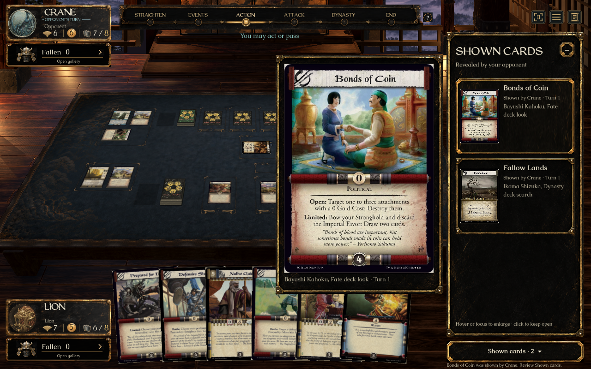
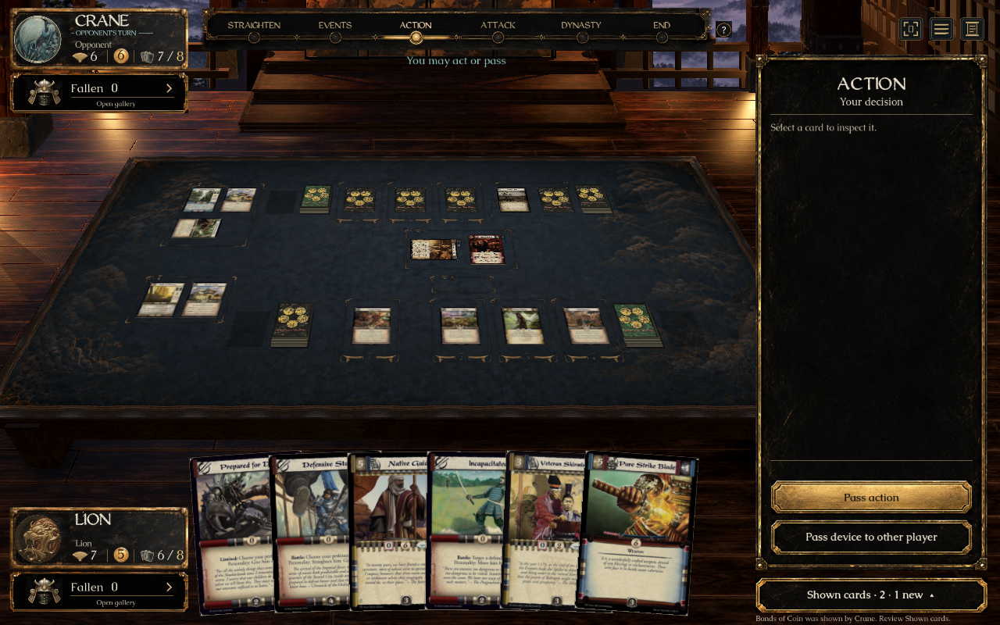

# Shown-card history (#315) — ready for individual review
**Current acceptance (2026-09-21): Alfredo approved previews 1–4. Merge is contingent on Mendon approving and passing checks; his review is pending. Previews 5–8 remain unapproved.** See the [current decision](../decisions/2026-09-21-first-four-ui-review-approval.md), which supersedes earlier acceptance wording below.

This is the second of eight approved UI previews; #339 is also ready for individual review. The remaining six are pending. **No merge into main is authorized.** PR [#393](https://github.com/alfredoh7/l5r-emperor/pull/393) remains a draft stacked on the isolated #339 preview. Completing checks or accepting the appearance does not grant merge permission.

## Open the prepared demo

On Alfredo's Mac: [L5R Shown Cards — Review.app](../../artifacts/L5R%20Shown%20Cards%20-%20Review.app).

The local app builds this checkout and opens a prepared match with Fallow Lands already shown through Ikoma Shizuka's published ability. It does not fetch, switch branches or merge main. The app is generated locally; the portable checked-in entry point is `Review Shown Cards.command`. Recreate the Mac app in another checkout with:

```sh
python3 tools/create-review-launcher.py 'Review Shown Cards.command' 'L5R Shown Cards - Review'
```

Verified card scans use the existing private dependency [catalogue-art-ui-eight-20260921-r2](https://github.com/alfredoh7/l5r-emperor/releases/tag/catalogue-art-ui-eight-20260921-r2), already installed in this checkout. Bulk artwork stays out of Git.

## Short review checklist

1. Hover **Fallow Lands** in the sidebar. Its full card face should appear beside the history. Click the row to keep that inspection open; close it with **Close inspection** or Escape.
2. Minimize the frame using its top-right control or the **Shown cards** footer.
3. Click the demo's **Show another card** button above the table. Bayushi Kahoku's published ability reveals **Bonds of Coin**. The minimized footer should show **2 · 1 new**, with a static highlight.
4. Open **Shown cards** again. Both entries remain available, with the newest first, who showed it, the source/effect and turn. The unread cue clears. Hover or click either entry; keyboard focus also enlarges a card.
5. Use **Restart demo** to return to the first reveal and repeat. The two controls above the table exist only in this prepared review mode.

## Implementation and approved direction

- Implements concept B's right sidebar, restrained list entries, full-card inspection beside the frame, and persistent minimized count. Reuses approved lacquer assets, Caudex and WeatheredQuill. The reference is the parent checkout's `artifacts/ui-eight-design-review-2026-09-20/images/02-shown-cards-b.png`; native output was inspected against it. Actual verified scans and game state replace illustrative generated content; no exact full-screen pixel-equivalence claim is made.
- Reads only the live engine/server `MatchView.ShownCards` record. The face renderer receives a presentation-only printed card made from that record's definition. There is no lookup of a hidden card instance, hand or deck.
- Shows only the opponent's deliberate reveals. Records stay available even after the shown card moves. The list reconstructs from the server snapshot after reconnect; client state stores only presentation identity and read position.
- A new required decision brings the decision sidebar back into view. Inspecting history sends no game command. New arrivals have a static badge, including with reduced motion.
- Reserves a footer below the inspector. The generic chooser's source thumbnail is slightly shorter so its cost controls remain accessible; full-size source inspection is preserved.
- Adds a client-only match identity: stable for a reconnect to the same server/room, fresh for new local Practice. No Core rules or wire schema changes.

## Verified evidence

- `bash tools/check.sh --skip-client`: all requested checks passed in `artifacts/shown-final-deterministic.log`, including 34/34 AI, 8/8 server and 9/9 client transport checks. Client compilation passed with zero warnings/errors; Godot import passed.
- New live transport regression uses two real client sessions and a local server: private search before the reveal, identical public reveal on both seats, disconnect/resume, reconstruction by a fresh client, and continued hand/deck privacy. This is end-to-end transport evidence, not a claim of two graphical clients or an external Mac/Windows match.
- `bash tools/check-shown-cards.sh`: native Mac 1920×1080 with normal motion and 1280×800 with reduced motion passed. Checks exercise hover, pin/close, keyboard focus, two actual published-ability reveals, unread arrival while minimized, both seats, history scrolling and new-match reset. Popup bounds are asserted after layout settles.
- A final 1280×800 reduced-motion pass also confirms that an incoming real Yumaru decision closes the history and exposes **Confirm choice**. The long-history test uses 14 fixture records made by copying the two real reveals; it is a scrolling stress test, not 14 separate published ability activations.
- Compact #339 review navigation and cost-choice regression passed after the source-thumbnail adjustment. Times of Strife at 1280×800 and Harsh Choices' last-province decision at 1280×720 passed; screenshots were inspected for footer/control overlap.
- Actual Mac `.app` launch verified through the desktop: prepared first reveal, minimize, **Show another card**, unread badge, both history entries, pinned full-card inspection and **Restart demo** all worked. The prepared first-reveal window was left open for Alfredo.





## Remaining acceptance and limits

Alfredo's UI acceptance and Mendon's review remain outstanding. Native Windows graphical play and an external two-machine match have not been performed. CI results belong to the actual pushed PR revision and are separate from these local checks.

The preview stack contains main `0d694f02` plus the approved unmerged UI lineage. Inherited stabilization rules candidates remain unapproved as recorded in the eight-task plan. The main branch and root checkout were not changed. **This preview must not be merged without Alfredo's explicit go-ahead.**
