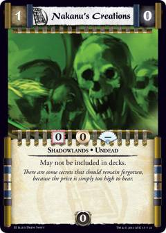
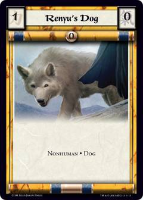
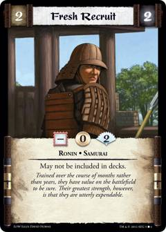
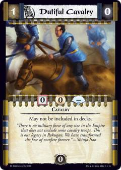
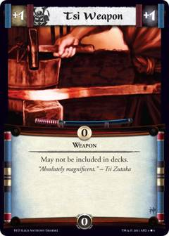
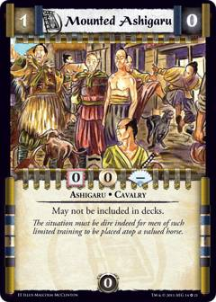
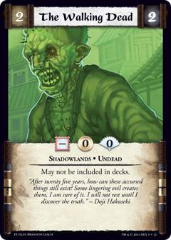

# Created-card scans needed

**2026-09-29 update:** User-supplied full-card scans fulfilled Natural Aviary's Falcon, Our Ancestor's Call/Offering Reverence's Ancestor Spirit, Crippled Sensei's Maimed Retainer, Kitsune Kichi's Badger, Kakita Saki's Armor, and Yari of Air's Air Yari. The user also supplied the matching Oracle Proxy scans for Hisano's Guide, Emerald Magistrate, Mounted Ashigaru, Assassin, and Readied Blade. These are packaged in the new created-card waves with gameplay tests; the historical request rows below remain for provenance and should no longer be treated as blockers for those cards.

Some cards create a card ("Create a 2F Follower and attach it to ..."). Oracle of the Void publishes a "Proxy" scan for most of them (printed "May not be included in decks."), and the engine plays created cards from those scans (`docs/decisions/2026-09-20-created-cards-from-proxy-scans.md`). A few creators have no scan that matches their text, and a few have only a near miss. Mendon's ruling (questions 9 and 10 of that decision) is that **the near misses are not used in the game** and that Mendon and Alfredo are asked to make scans that match the creators' text. This page lists every one: **9 near misses** (section A) and **17 creators with no scan at all** (section B). Nothing here is built until a scan is checked off.

Out of scope (Mendon, question 11): Emerald Champion (9746), Hideshi's Guardian (9747), Phoenix Yojimbo (9748), Spirit of the Bear (9750) and Benika's Pride (9744) are not Emperor Edition cards (they lack the Emperor mark at the bottom of the scan) and no creator was paired with any of them; they are removed from every list. Benika's Pride had been listed as a second candidate for Soldiers of Clay; it is dropped.

## How to supply a scan

- One image per row, a full card face like the Oracle scans (750 x 1050 pixels, JPEG), in the Emperor Edition frame with the Emperor mark, printed with the type line, stats, keywords and text exactly as the "Should be" / "Wanted" column says, and the words "May not be included in decks." above any other text.
- Save it as `assets/requested-scans/<name>.jpg` (each row gives the exact file name), for example `assets/requested-scans/ronin.jpg`. Where one card serves two creators (Colonial Farm and Exotic Farmlands; Our Ancestor's Call and Offering Reverence) both rows name the same file: make it once. 24 scans cover the 26 rows.
- Tick the box in the row (`M` Mendon, `A` Alfredo) and say in the PR or a comment who made it. Whoever ticks last opens the packaging task: a `tools/content/package_*_wave_N.py` wave that publishes the scan as a created-only card of its real type (`CreatedOnly`), a spec on the creating card, and the tests, exactly as for the scans already published (Lion Ancestor, Water Bo, Dak-ho's Men, ...). The near-miss scans stay out of the game meanwhile.
- Rows that say "has your Clan alignment keyword" are one scan for every Clan: the engine gives the created card its creator's Stronghold Clan and Clan keyword when it is created (as Venerated Sensei).

## A. Near misses (9): a scan exists, but it is not the card the text describes

### A1. Plague of Flesh

| Creating card | Near-miss scan | Should be (the proposed correction) | File and checklist |
|---|---|---|---|
| **Plague of Flesh** (oracle-l5r-5968, Follower, Promotional-Celestial) Exact text: After this card enters play: Lose 5 Honor. / Reaction: After this card enters play, once per game: Create two 1F Shadowlands • Ashigaru • Plague • Undead Followers and attach them to one or two of your Personalities. | **Nakanu's Creations** (oracle-l5r-10011) Follower, 1F/0C, Shadowlands • Undead  | **Follower**, 1F, keywords: Shadowlands • Ashigaru • Plague • Undead; no other text. Two of them are created. The near miss (Nakanu's Creations) is already used by Nakanu Technique and stays as it is. | `assets/requested-scans/plague-follower.jpg` - [ ] M: matching scan made - [ ] A: matching scan made |

### A2. Soldiers of Clay

| Creating card | Near-miss scan | Should be (the proposed correction) | File and checklist |
|---|---|---|---|
| **Soldiers of Clay** (oracle-l5r-7328, Spell, Promotional-Celestial) Exact text: Attaches to an Earth Shugenja paying 1 less Gold. / Limited: Destroy this card and target one to three of your Personalities: Create three 1F Nonhuman • Clay Soldier Followers and attach them to them. | **Renyu's Dog** (oracle-l5r-10815) Follower, 1F/0C, Dog • Nonhuman  | **Follower**, 1F, keywords: Nonhuman • Clay Soldier; no other text. Three of them are created. | `assets/requested-scans/clay-soldier.jpg` - [ ] M: matching scan made - [ ] A: matching scan made |

### A3. Swell the Ranks

| Creating card | Near-miss scan | Should be (the proposed correction) | File and checklist |
|---|---|---|---|
| **Swell the Ranks** (oracle-l5r-7689, Strategy, Promotional-Celestial) Exact text: Battle: Create a 2F/2C/2PH Ronin Personality on your side at the current battlefield. Remove him from the game after this battle ends. | **Fresh Recruit** (oracle-l5r-9997) Personality, 2F/2C/2PH, Ronin • Samurai  | **Personality**, 2F/2C/2PH, keywords: Ronin; no other text. The near miss also has Samurai. | `assets/requested-scans/ronin.jpg` - [ ] M: matching scan made - [ ] A: matching scan made |

### A4. Natural Aviary

| Creating card | Near-miss scan | Should be (the proposed correction) | File and checklist |
|---|---|---|---|
| **Natural Aviary** (oracle-l5r-9866, Region, The Shadow's Embrace) Exact text: Limited, 2 Gold: Create a 1F Nonhuman • Falcon • Cavalry Follower and attach it to your target Personality. | **Dutiful Cavalry** (oracle-l5r-10003) Follower, 1F/0C, Cavalry  | **Follower**, 1F, keywords: Nonhuman • Falcon • Cavalry; no other text. The near miss lacks Nonhuman and Falcon. | `assets/requested-scans/falcon.jpg` - [ ] M: matching scan made - [ ] A: matching scan made |

### A5. Yari of Air

| Creating card | Near-miss scan | Should be (the proposed correction) | File and checklist |
|---|---|---|---|
| **Yari of Air** (oracle-l5r-9894, Spell, The Shadow's Embrace) Exact text: After this card enters play, if this Shugenja is Air: Gain 1 Honor. / Limited: Once per game: Create a +1F/+1C Air • Weapon Item with the ability, "Battle: Give each Personality and Follower in the enemy army -1F" and attach it to one of your Personalities. | **Tsi Weapon** (oracle-l5r-9715) Item, 1F/1C, Weapon  | **Item**, +1F/+1C, keywords: Air • Weapon; text: "Battle: Give each Personality and Follower in the enemy army -1F.". The near miss has neither Air nor the ability. | `assets/requested-scans/yari-of-air.jpg` - [ ] M: matching scan made - [ ] A: matching scan made |

### A6. Colonial Farm

| Creating card | Near-miss scan | Should be (the proposed correction) | File and checklist |
|---|---|---|---|
| **Colonial Farm** (oracle-l5r-10231, Holding, Promotional-Emperor) Exact text: Enters play for 1 less Gold if you are a Lion Clan player. / Bow: Produce 5 Gold. / Limited, Bow: Create a 1F Ashigaru  Follower and attach it to your target Personality. | **Mounted Ashigaru** (oracle-l5r-10010) Follower, 1F/0C, Cavalry • Ashigaru  | **Follower**, 1F, keywords: Ashigaru; no other text. Also serves Exotic Farmlands (same card). The near miss also has Cavalry. | `assets/requested-scans/ashigaru-1f.jpg` - [ ] M: matching scan made - [ ] A: matching scan made |

### A7. Abdollah

| Creating card | Near-miss scan | Should be (the proposed correction) | File and checklist |
|---|---|---|---|
| **Abdollah** (oracle-l5r-10667, Personality, Gates of Chaos) Exact text: After Abdollah enters play, lose 2 Honor and create a 2F/2C/0PH Nonhuman • Shadowlands • Undead Personality. | **The Walking Dead** (oracle-l5r-9741) Personality, 2F/2C/0PH, Shadowlands • Undead  | **Personality**, 2F/2C/0PH, keywords: Nonhuman • Shadowlands • Undead; no other text. The near miss lacks Nonhuman. | `assets/requested-scans/undead-nonhuman.jpg` - [ ] M: matching scan made - [ ] A: matching scan made |

### A8. New Cavalry Tactics

| Creating card | Near-miss scan | Should be (the proposed correction) | File and checklist |
|---|---|---|---|
| **New Cavalry Tactics** (oracle-l5r-10724, Strategy, Gates of Chaos) Exact text: Engage, 3 Gold: Target your Personality. Create and attach two, or three if the target is a Commander, 1F Elephant • Nonhuman • Cavalry Followers to him. | **Dutiful Cavalry** (oracle-l5r-10003) Follower, 1F/0C, Cavalry  | **Follower**, 1F, keywords: Elephant • Nonhuman • Cavalry; no other text. Two, or three if the target is a Commander, are created. | `assets/requested-scans/elephant.jpg` - [ ] M: matching scan made - [ ] A: matching scan made |

### A9. Exotic Farmlands

| Creating card | Near-miss scan | Should be (the proposed correction) | File and checklist |
|---|---|---|---|
| **Exotic Farmlands** (oracle-l5r-10727, Strategy, Gates of Chaos) Exact text: Battle, X Gold: Target your Personality. Create and attach to him a 1F Ashigaru Follower for every 3 Gold you paid, rounded down. | **Mounted Ashigaru** (oracle-l5r-10010) Follower, 1F/0C, Cavalry • Ashigaru  | **Follower**, 1F, keywords: Ashigaru; no other text. Same card as Colonial Farm's: one scan serves both. One is created for every 3 Gold paid. The near miss also has Cavalry. | `assets/requested-scans/ashigaru-1f.jpg` - [ ] M: matching scan made - [ ] A: matching scan made |

## B. No scan at all (17)

| # | Creating card | Wanted | File and checklist |
|---|---|---|---|
| B1 | **Heart of Fudo** (oracle-l5r-3014, Item, Promotional-Celestial) Exact text: Limited: Remove from the game three of your Fudo Holdings with different titles: Create a 10F/5C/0PH Nonhuman • Fudo Personality with the trait "Cards' effects will not bow this Personality or move him home." / Reaction: Before one of your Nonhumans with 8 or higher Force is destroyed, destroy this card: Negate the Nonhuman's destruction. | **Personality**, 10F/5C/0PH, keywords: Nonhuman • Fudo; text: "Cards' effects will not bow this Personality or move him home." | `assets/requested-scans/fudo.jpg` - [ ] M: scan uploaded - [ ] A: scan uploaded |
| B2 | **Heartlands** (oracle-l5r-3023, Region, Promotional-Celestial) Exact text: Limited, 3 Gold: Create a 1F/1C/1PH Personality with your Clan Alignment. | **Personality**, 1F/1C/1PH, keywords: (none); text: "This card has your Clan alignment keyword." | `assets/requested-scans/clan-personality-1f.jpg` - [ ] M: scan uploaded - [ ] A: scan uploaded |
| B3 | **Humble Farm** (oracle-l5r-9797, Holding, The Shadow's Embrace) Exact text: Bow: Produce 2 Gold. / Battle/Open: Destroy this Holding to create a 2F Ashigaru Follower and attach it to your target Personality. | **Follower**, 2F, keywords: Ashigaru; no other text | `assets/requested-scans/ashigaru-2f.jpg` - [ ] M: scan uploaded - [ ] A: scan uploaded |
| B4 | **Kakita Saki** (oracle-l5r-9814, Personality, The Shadow's Embrace) Exact text: Limited: Target your Personality: Create a +2F Armor Item with the trait, "Melee and Ranged Attacks targeting this Personality have -3 strength" and attach it to him. | **Item**, +2F/+0C, keywords: Armor; text: "Melee and Ranged Attacks targeting this Personality have -3 strength." | `assets/requested-scans/saki-armor.jpg` - [ ] M: scan uploaded - [ ] A: scan uploaded |
| B5 | **Kitsune Kichi** (oracle-l5r-9829, Personality, The Shadow's Embrace) Exact text: Reaction: After Kichi enters play: Create a 3F/2C/3PH Mantis Clan • Nonhuman • Badger • Spirit Personality with the ability, "Battle: Target an enemy Personality: Reduce his Force to 0." | **Personality**, 3F/2C/3PH, keywords: Mantis Clan • Nonhuman • Badger • Spirit; text: "Battle: Target an enemy Personality: Reduce his Force to 0." | `assets/requested-scans/kichi-badger-a.jpg` - [ ] M: scan uploaded - [ ] A: scan uploaded |
| B6 | **Our Ancestor's Call** (oracle-l5r-9886, Spell, The Shadow's Embrace) Exact text: Battle: If this Shugenja is opposed, destroy this card: Create a 2F/2C/3PH Samurai • Ancestor • Spirit Personality with your Clan alignment at the current battlefield. If this Shugenja is Water and defending, create two such Personalities instead. | **Personality**, 2F/2C/3PH, keywords: Samurai • Ancestor • Spirit; text: "This card has your Clan alignment keyword.". Also serves Offering Reverence (same card). Two are created if the Shugenja is Water and defending. | `assets/requested-scans/ancestor-clan.jpg` - [ ] M: scan uploaded - [ ] A: scan uploaded |
| B7 | **Crippled Sensei** (oracle-l5r-9899, Strategy, The Shadow's Embrace) Exact text: As a Focus Effect: After this duel ends, choose a player who loses 2 Honor. / Reaction: After one of your Personalities is destroyed: Create a Maimed • Retainer Holding with the ability, "Battle/Open: Destroy this card and target a Personality: Straighten him. Rehonor him." | **Holding**, (no Gold Cost), keywords: Maimed • Retainer; text: "Battle/Open: Destroy this card and target a Personality: Straighten him. Rehonor him.". Enters play at home like any Holding. | `assets/requested-scans/crippled-sensei-holding.jpg` - [ ] M: scan uploaded - [ ] A: scan uploaded |
| B8 | **Offering Reverence** (oracle-l5r-10031, Event, Seeds of Decay) Exact text: After you reveal cards in your Provinces at the start of your turn, if this Event is face-up in one of them, for each dead Personality in your discard pile, create a 2F/2C/3PH Samurai • Ancestor • Spirit Personality with your Clan Alignment. If this created no Personalities, you may shuffle this Event into your deck instead of discarding it normally. | **Personality**, 2F/2C/3PH, keywords: Samurai • Ancestor • Spirit; text: "This card has your Clan alignment keyword.". Same card as Our Ancestor's Call's: one scan serves both. One is created for each dead Personality in your discard pile. | `assets/requested-scans/ancestor-clan.jpg` - [ ] M: scan uploaded - [ ] A: scan uploaded |
| B9 | **Overlooked Palace** (oracle-l5r-10036, Holding, Seeds of Decay) Exact text: Bow: Produce 2 Gold. / Ninja Limited: Destroy this card to create a 0F/2C/0PH Ninja Personality with your Clan Alignment. | **Personality**, 0F/2C/0PH, keywords: Ninja; text: "This card has your Clan alignment keyword." | `assets/requested-scans/clan-ninja.jpg` - [ ] M: scan uploaded - [ ] A: scan uploaded |
| B10 | **The Tower of Vigilance** (oracle-l5r-10612, Holding, Gates of Chaos) Exact text: (Fortifications attach, straightened, to the Province from which they entered play.) / Engage, Bow: If you have any units at this battlefield, create a 0F/2C/2PH Samurai • Guard Personality there. Remove him from the game after this battle ends. | **Personality**, 0F/2C/2PH, keywords: Samurai • Guard; no other text. Removed from the game after the battle ends. | `assets/requested-scans/guard.jpg` - [ ] M: scan uploaded - [ ] A: scan uploaded |
| B11 | **Ashalan Ambush** (oracle-l5r-10715, Strategy, Gates of Chaos) Exact text: Limited,8 Gold: Create a 4F/4C/0PH Ashalan • Nonhuman • Shugenja Personality. | **Personality**, 4F/4C/0PH, keywords: Ashalan • Nonhuman • Shugenja; no other text | `assets/requested-scans/ashalan.jpg` - [ ] M: scan uploaded - [ ] A: scan uploaded |
| B12 | **The Onyx Dueling Circle** (oracle-l5r-10757, Holding, Promotional-Emperor) Exact text: Bow: Produce 2 Gold. / Limited, Bow: Destroy your target Shugenja. Create a 5F/2C/0PH Nonhuman • Oni • Shadowlands Personality. Destroy this Holding. Lose 4 Honor. | **Personality**, 5F/2C/0PH, keywords: Nonhuman • Oni • Shadowlands; no other text | `assets/requested-scans/onyx-oni.jpg` - [ ] M: scan uploaded - [ ] A: scan uploaded |
| B13 | **Kitsune Yamazaru** (oracle-l5r-10856, Personality, Aftermath) Exact text: Interrupt: After you Recruit Yamazaru, create a 3F/2C/3PH Mantis Clan • Monkey • Nonhuman • Spirit Personality with the ability, "Battle: Discard a card to give a target enemy Personality or Follower a Force penalty equal to the card's Focus Value." | **Personality**, 3F/2C/3PH, keywords: Mantis Clan • Monkey • Nonhuman • Spirit; text: "Battle: Discard a card to give a target enemy Personality or Follower a Force penalty equal to the card's Focus Value." | `assets/requested-scans/yamazaru-monkey.jpg` - [ ] M: scan uploaded - [ ] A: scan uploaded |
| B14 | **Isawa Tsumaro** (oracle-l5r-10863, Personality, Aftermath) Exact text: Air Home Engage: Move your target Air Shugenja home. Create a 0F/3C/0PH Air • Illusion • Shugenja Personality at the current battlefield; remove him from the game after the battle ends. While the Illusion is there, abilities on the target's spells have Home. | **Personality**, 0F/3C/0PH, keywords: Air • Illusion • Shugenja; no other text. Removed from the game after the battle ends. Created at the current battlefield. | `assets/requested-scans/illusion.jpg` - [ ] M: scan uploaded - [ ] A: scan uploaded |
| B15 | **Kitsune Kichi** (oracle-l5r-10883, Personality, Aftermath) Exact text: After Kichi enters play, lose 3 Honor and create a 4F/2C/0PH Badger • Nonhuman • Shadowlands • Spirit Personality with the ability, "Battle, Bow: Melee 4 Attack." | **Personality**, 4F/2C/0PH, keywords: Badger • Nonhuman • Shadowlands • Spirit; text: "Battle, Bow: Melee 4 Attack." | `assets/requested-scans/kichi-badger-b.jpg` - [ ] M: scan uploaded - [ ] A: scan uploaded |
| B16 | **Band of Brothers** (oracle-l5r-10891, Follower, Aftermath) Exact text: After this Follower enters play, target one or two of your Personalities. Create and attach a 1F Ronin Follower to each of them. | **Follower**, 1F, keywords: Ronin; no other text. One is created for each of one or two Personalities. | `assets/requested-scans/ronin-follower-1f.jpg` - [ ] M: scan uploaded - [ ] A: scan uploaded |
| B17 | **Yojimbo of Earth** (oracle-l5r-10924, Spell, Aftermath) Exact text: Earth Limited, Bow: Create a 1F Clay Soldier • Nonhuman • Yojimbo Follower and attach it to your target Shugenja without Followers. | **Follower**, 1F, keywords: Clay Soldier • Nonhuman • Yojimbo; no other text | `assets/requested-scans/clay-yojimbo.jpg` - [ ] M: scan uploaded - [ ] A: scan uploaded |

## C. A question that is not a scan

**Basic Lesson** (oracle-l5r-713, Second City): "Limited: Create a (bowed) Holding with the trait "Bow this card: Produce 3 Gold." Negate your Stronghold's straightening (this turn). Open: Destroy your target Holding: Create a Samurai Personality with 3C/2PH and Force equal to the Holding's base Gold Cost." The Holding is Questionable Resources (published in #407) and the Personality can be Hired Samurai (oracle-l5r-10811, a 3C/2PH Samurai whose Force is set per instance since #405), so no new scan is needed. What is needed is a ruling: a Limited action is taken in your own Action phase, after this turn's Straighten phase, so "(this turn)" cannot negate the Straighten phase the words seem to mean. Which straightening is negated (your next one?) - Mendon.

- [ ] M: ruling given
